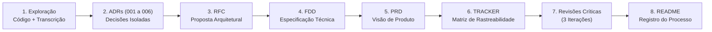

# Documentação de Arquitetura e Produto — Sistema de Webhooks de Notificação de Pedidos (OMS)

## 1. Sobre o Desafio

Este projeto consiste na produção de um pacote completo e rastreável de **Design Docs** (**PRD**, **RFC**, **FDD**, **6 ADRs** e **Tracker de Rastreabilidade**) para a nova funcionalidade de **Sistema de Webhooks de Notificação de Pedidos (*Outbound*)** de um *Order Management System* (OMS) B2B existente em Node.js, TypeScript, Express, Prisma e MySQL 8.0.

O ponto de partida do trabalho foi a gravação literal de uma reunião técnica de 55 minutos ([`TRANSCRICAO.md`](./TRANSCRICAO.md)) entre Tech Lead (Larissa), Product Manager (Marcos), Engenheiro Sênior de Plataforma (Diego), Engenheiro Pleno do módulo de Pedidos (Bruno) e Engenheira de Segurança (Sofia), combinada à inspeção direta do código-fonte real da aplicação (`src/`, `prisma/`, `tests/`). O objetivo central foi transformar decisões faladas e padrões implícitos do código em especificações técnicas acionáveis para a engenharia e claras para produto, mantendo **rastreabilidade estrita** (zero invenção de requisitos, separação explícita entre o que foi aprovado, descartado, adiado ou deixado pendente de definição) e sem modificar nenhuma linha de código da aplicação.

---

## 2. Ferramentas de IA Utilizadas e Seus Papéis

| Ferramenta | Papel Desempenhado no Processo |
| :--- | :--- |
| **Google Antigravity (Agentic AI Coding Assistant)** | Ambiente principal de engenharia assistida por IA. Utilizado para: (1) leitura e mapeamento estático de todos os módulos, middlewares, schemas Prisma e testes do repositório; (2) extração estruturada de decisões, requisitos, métricas, alternativas descartadas e itens fora de escopo a partir de [`TRANSCRICAO.md`](./TRANSCRICAO.md); (3) redação incremental dos documentos sob diferentes personas técnicas (*Software Architect*, *Tech Lead*, *Senior Backend Engineer*, *Product Manager* e *Revisor Técnico*); e (4) execução de três rodadas de auditoria crítica (verificação de alucinações, revisão de implementabilidade do FDD e alinhamento cruzado entre PRD, RFC, FDD e ADRs). |

---

## 3. Workflow Adotado (Ordem Real de Execução)

O trabalho foi conduzido em **8 etapas sequenciais e controladas**, validando cada entrega antes de avançar para o próximo documento e mantendo uma regra rígida de modificar exclusivamente o arquivo-alvo de cada etapa:



1. **Etapa 1 — Análise Exploratória e Diagnóstico (Sem alteração de arquivos):**
   - Inspeção completa do repositório (`package.json`, `prisma/schema.prisma`, `src/app.ts`, `src/server.ts`, `src/config/*`, `src/middlewares/*`, `src/shared/*`, `src/modules/orders/*`, `tests/orders.test.ts`) e leitura integral da [`TRANSCRICAO.md`](./TRANSCRICAO.md).
   - Consolidação de um relatório estruturado separando **Decisões Confirmadas**, **Requisitos Explícitos (Funcionais e Não Funcionais)**, **Alternativas Descartadas**, **Questões em Aberto / Funcionalidades Adiadas**, **Métricas Quantitativas** e **Informações Não Confirmadas**, submetido para aprovação antes de gerar qualquer arquivo.
2. **Etapa 2 — Formalização das Decisões Arquiteturais (`docs/adrs/ADR-001` a `ADR-006`):**
   - Criação dos 6 ADRs cobrindo os pilares da solução: Transactional Outbox no MySQL (`ADR-001`), Retry com Backoff Exponencial e DLQ (`ADR-002`), Autenticação HMAC-SHA256 com Secret por Endpoint e Grace Period de 24h (`ADR-003`), Entrega *At-Least-Once* com `X-Event-Id` (`ADR-004`), Worker Separado com Polling de 2s (`ADR-005`) e Reutilização dos Padrões Arquiteturais do OMS (`ADR-006`).
3. **Etapa 3 — Consolidação da Proposta Técnica (`docs/RFC.md`):**
   - Com os ADRs prontos, produção do RFC conciso (nível de arquitetura) apresentando o fluxo geral, as 7 alternativas discutidas e descartadas na reunião, as 6 questões em aberto/adiadas, impactos no sistema existente e links para os ADRs.
4. **Etapa 4 — Desenho Detalhado de Implementação (`docs/FDD.md`):**
   - Especificação profunda voltada ao desenvolvedor: modelos de dados (diferenciando tabelas literalizadas na reunião e detalhes físicos da Sprint 1), diagramas de sequência/fluxo (Outbox, Worker e Backoff/DLQ), contratos de 7 endpoints HTTP + contrato do `POST` outbound enviado ao cliente, matriz de erros `WEBHOOK_*`, estratégias de resiliência, observabilidade e a seção obrigatória **"Integração com o sistema existente"** detalhando 8 arquivos reais do repositório.
5. **Etapa 5 — Consolidação de Produto e Negócio (`docs/PRD.md`):**
   - Elaboração do documento de requisitos de produto focado na dor dos clientes B2B (Atlas Comercial, MaxDistribuição e Nova Cargo), cenários de uso, metas quantitativas, escopo incluso vs. fora de escopo, 11 requisitos funcionais, 8 requisitos não funcionais, riscos com probabilidade/impacto/mitigação e critérios de aceite.
6. **Etapa 6 — Matriz de Rastreabilidade (`docs/TRACKER.md`):**
   - Varredura de todos os documentos gerados para construir uma tabela de 90 itens rastreados (`100%` de cobertura dos itens identificados, sendo `81,11%` com fonte `TRANSCRICAO` no formato `[hh:mm] Nome` e `18,89%` com fonte `CODIGO` apontando para 17 arquivos reais distintos do repositório).
7. **Etapa 7 — Três Ciclos de Revisão Crítica e Refinamento:**
   - **Ciclo 1:** Auditoria rigorosa contra alucinações (verificando afirmações sem lastro direto na transcrição ou no código).
   - **Ciclo 2:** Revisão do `FDD.md` sob a ótica de um *Senior Backend Engineer* encarregado de implementar a feature (buscando fluxos ambíguos, contratos incompletos e integrações subespecificadas).
   - **Ciclo 3:** Comparação cruzada entre `PRD`, `RFC`, `FDD` e `ADRs` para eliminar contradições, vazamento de escopo entre documentos e links quebrados.
8. **Etapa 8 — Documentação do Processo (`README.md`):**
   - Registro transparente do fluxo, dos prompts utilizados e das correções efetuadas.

---

## 4. Prompts Customizados Efetivamente Utilizados

Abaixo estão 4 dos prompts customizados utilizados durante a condução das etapas de exploração, especificação técnica, rastreabilidade e revisão crítica:

### Prompt 1 — Exploração Inicial e Extração Classificada (Persona: *Senior Software Architect*)
```text
Atue como um Software Architect sênior especializado em documentação técnica de sistemas distribuídos. Preciso criar uma serie de documentações seguindo a risca as orientacoes contidas em @[orientacoes.md] 
Mas quero fazer documentos por parte.
Primeiramente analise o repositorio @[mba-ia-desafio-design-docs-com-ia] e as transcrições contidas em @[mba-ia-desafio-design-docs-com-ia/TRANSCRICAO.md] 

O objetivo é compreender o sistema OMS existente e identificar os requisitos e decisões necessários para implementar o Sistema de Webhooks de Notificação de Pedidos.

Realize as seguintes atividades:
- Identifique a arquitetura atual do sistema, módulos, serviços, endpoints, persistência e padrões existentes.
- Identifique os pontos reais de integração da nova funcionalidade.
- Extraia todas as decisões técnicas discutidas na transcrição, incluindo timestamp e participante.
- Separe requisitos funcionais e não funcionais.
- Identifique alternativas descartadas, funcionalidades adiadas e questões em aberto.
- Identifique métricas e restrições quantitativas mencionadas na reunião.
- Relacione cada descoberta aos arquivos reais do código ou aos timestamps da transcrição.

Apresente os resultados de maneira estruturada, diferenciando:
- Decisões confirmadas
- Requisitos explícitos
- Alternativas descartadas
- Questões em aberto
- Informações não confirmadas

Não invente informações. Não modifique nenhum arquivo nesta etapa.
Ao terminar, apresente um resumo da análise para minha aprovação.
```

### Prompt 2 — Especificação do FDD (Persona: *Senior Backend Engineer*)
```text
Atue como Senior Backend Engineer especializado em Node.js, TypeScript, MySQL, Prisma e sistemas distribuídos.

Produza @[mba-ia-desafio-design-docs-com-ia/docs/FDD.md] para a implementação do Sistema de Webhooks de Notificação de Pedidos.

Utilize o código existente, a @[mba-ia-desafio-design-docs-com-ia/TRANSCRICAO.md], o RFC e os ADRs. E Sempre siga as orientações de cada fase em @[orientacoes.md]

O documento deve conter:
1. Contexto e motivação técnica
2. Objetivos técnicos
3. Escopo e exclusões
4. Fluxo de criação do evento na Transactional Outbox
5. Fluxo de processamento pelo worker
6. Fluxo de retry, backoff e DLQ
7. Contratos de pelo menos 4 endpoints HTTP, com exemplos JSON de request, response, headers e status codes
8. Matriz de erros utilizando o prefixo WEBHOOK_
9. Estratégias de resiliência, timeouts e fallback
10. Observabilidade com métricas, logs e tracing
11. Dependências e compatibilidade
12. Critérios de aceite técnicos
13. Riscos e mitigação

Inclua obrigatoriamente a seção "Integração com o sistema existente", identificando pelo menos 4 caminhos de arquivos reais do repositório e explicando exatamente como a funcionalidade se integrará a cada um.

Para cada contrato ou comportamento, identifique a origem na transcrição ou no código.
Quando um detalhe necessário não estiver decidido, identifique-o como pendente de definição, sem inventar uma decisão.
O FDD deve permitir que um desenvolvedor compreenda a implementação sem precisar reinterpretar toda a reunião.
Não implemente código e modifique somente @[mba-ia-desafio-design-docs-com-ia/docs/FDD.md].
```

### Prompt 3 — Auditoria de Rastreabilidade e Zero Alucinação
```text
Revise todos os documentos e identifique afirmações que não possuem origem verificável na @[mba-ia-desafio-design-docs-com-ia/TRANSCRICAO.md] e @[orientacoes.md] ou no código. Apresente os problemas e proponha correções sem inventar referências.
```

### Prompt 4 — Revisão de Implementabilidade do FDD e Consistência Cruzada
```text
Revise o FDD como um engenheiro sênior que precisará implementar a feature. Identifique contratos incompletos, fluxos ambíguos, erros não tratados e integrações insuficientemente explicadas. Corrija somente o que puder ser sustentado pelas fontes.

Compare PRD, RFC, FDD e ADRs. Identifique contradições, duplicações desnecessárias, decisões inconsistentes e links quebrados. Corrija os problemas respeitando a responsabilidade de cada documento.
```

---

## 5. Iterações e Ajustes Concretos Realizados

Após a geração inicial dos documentos, foram executadas **3 iterações principais de revisão crítica e correção**, nas quais extrapolações da IA, ambiguidades de fluxo e sobreposições entre documentos foram identificadas e corrigidas:

### Iteração 1 — Auditoria de Rastreabilidade contra Extrapolações da IA
Na primeira revisão completa confrontando os documentos gerados com a [`TRANSCRICAO.md`](./TRANSCRICAO.md) e o código-fonte, foram detectadas e corrigidas 6 extrapolações onde a IA havia apresentado detalhes de implementação inferidos como se fossem fatos fechados na reunião:
1. **Arquivos extras na árvore de diretórios do `FDD.md`:** A versão inicial da Seção 4.1 do `FDD.md` listava `webhook.publisher.ts` e `webhook.errors.ts`. Na transcrição (`[09:27]–[09:28] Bruno`), foram listados apenas `controller`, `service`, `repository`, `routes`, `schemas` e `webhook.worker.ts` (ou `webhook.processor.ts`), e no código real todas as classes de erro ficam centralizadas em `src/shared/errors/http-errors.ts`. Os dois arquivos extras foram removidos.
2. **Campos `subtotal_cents` e `discount_cents` no exemplo de payload do `FDD.md`:** O exemplo JSON das Seções 6.6 e 6.8 do `FDD.md` incluía `subtotal_cents` e `discount_cents`. Como em `[09:43] Diego` citou nominalmente apenas `total_cents` (*"os campos básicos da order tipo total_cents. Não manda items pra não inflar"*), esses dois campos foram removidos do exemplo e registrados em nota como **pendentes de definição**.
3. **Imprecisão sobre o contexto do vazamento de `secret` (`[09:22] Diego`):** Em `ADR-003`, `RFC`, `FDD` e `PRD`, o comentário de Diego em `[09:22]` (*"Já tivemos caso de cliente que vazou secret no log da aplicação dele"*) havia sido misturado com a configuração `redactPaths` do Pino interno do OMS (`src/shared/logger/index.ts`). Os textos foram corrigidos para deixar claro que o incidente histórico ocorreu no **ambiente do cliente** (motivando a secret por endpoint e a rotação com *grace period* de 24h), tratando a redaction no Pino do OMS separadamente como boa prática interna.
4. **Fronteira entre nomes de tabelas fechados na call e modelagem da Sprint 1 (`[09:46] Larissa`):** Na call foram nomeadas literalmente `webhook_outbox` (`[09:06] Diego`) e `webhook_dead_letter` (`[09:18] Diego`), enquanto a modelagem física completa ficou alocada na Sprint 1 (`[09:46] Larissa`). Foi adicionada uma nota explícita no `FDD.md` e no `RFC.md` distinguindo as tabelas/colunas confirmadas na reunião da modelagem física proposta para as tabelas de configuração e histórico de entregas.
5. **Convenções ilustrativas (`whsec_`, `sha256=`) e nomes de métricas:** Sinalizados explicitamente no `FDD.md` como convenções ilustrativas / pendentes de revisão de segurança (`[09:46] Sofia`).

### Iteração 2 — Revisão do `FDD.md` sob a Ótica de Implementação (*Senior Backend Engineer*)
Ao revisar o [`docs/FDD.md`](./docs/FDD.md) como o engenheiro responsável por codificar a feature, foram identificados e corrigidos 4 problemas técnicos:
1. **Inconsistência aritmética no fluxograma de Backoff (`1m, 5m, 30m, 2h, 12h`):** Na Seção 5.3 do `FDD.md`, o bloco de decisão `attempts < 5` listava apenas 4 intervalos (`1: 1m | 2: 5m | 3: 30m | 4: 2h`) e omitia o 5º intervalo de `12h`, o que levaria um desenvolvedor a mover o evento para a DLQ com apenas `2h36m` de janela acumulada em vez das **~15 horas (`14h36m`)** acordadas em `[09:17] Diego` e `[09:48] Larissa`. O diagrama foi corrigido e acompanhado de uma tabela passo a passo cobrindo o envio inicial e todas as **5 retentativas** (`1m -> 5m -> 30m -> 2h -> 12h`).
2. **Escopo do gatilho e *fan-out* para múltiplos webhooks ativos do mesmo cliente:** Esclarecido na Seção 5.1 que o gatilho confirmado ocorre exclusivamente em `OrderService.changeStatus` (`PATCH /api/v1/orders/:id/status`, `[09:40] Bruno`), e que quando um mesmo `customer_id` possui múltiplos webhooks ativos inscritos no novo status (`[09:44] Sofia`), o sistema insere **1 registro independente na `webhook_outbox` por endpoint inscrito**.
3. **Snippet exato de integração em `src/modules/orders/order.service.ts`:** A Seção 9.1 foi enriquecida com o trecho real da transação `prisma.$transaction`, demonstrando que a entidade `order` carregada na linha 132 já contém `id`, `orderNumber`, `customerId` e `totalCents` sem exigir queries extras.
4. **Integração com `validate.middleware.ts` e `error.middleware.ts`:** Adicionada a Seção 9.8 especificando a validação via `z.nativeEnum(OrderStatus)` (espelhando `src/modules/orders/order.schemas.ts`), o envelope JSON de erro `{ error: { code, message, details } }` e a verificação de existência de `Customer` (`NotFoundError('Customer')`).

### Iteração 3 — Comparação Cruzada (`PRD` vs. `RFC` vs. `FDD` vs. `ADRs`) e Correção de Links
Na revisão transversal entre todos os documentos do pacote:
1. **Eliminação de contradição textual sobre o momento de ida para a DLQ:** Alguns trechos do `PRD.md`, `RFC.md`, `FDD.md` e `ADR-002` ainda diziam *"após a 5ª falha"*, enquanto o fluxo de backoff exigia 5 retentativas após a falha inicial. Todos os documentos foram unificados para **"após esgotar as 5 tentativas de retry (`1m, 5m, 30m, 2h, 12h`, ~15h)"**.
2. **Remoção de vazamento de detalhes de implementação no `PRD.md`:** As Seções 6, 7, 9 e 12 do `PRD.md` citavam nomes de arquivos TypeScript (`src/worker.ts`, `order.service.ts`), middlewares (`authenticate`, `requireRole('ADMIN')`) e chaves JSON internas que duplicavam o `FDD.md`. O `PRD.md` foi enxugado para manter o foco em produto e negócio, apontando para o `FDD.md` quanto aos contratos técnicos.
3. **Inclusão do limite de 5 webhooks ativos por cliente (`[09:44] Sofia`, `[09:45] Diego`) nos contratos:** A regra citada na Seção 5.1 do `FDD.md` foi refletida também no contrato `POST /api/v1/webhooks` (Seção 6.1), na Matriz de Erros (`WEBHOOK_LIMIT_EXCEEDED`, Seção 7) e no requisito `RF-01` do `PRD.md`.
4. **Correção de links quebrados/locais:** Na Seção 9 do `FDD.md`, 14 links apontavam para caminhos absolutos da máquina local (`file:///a:/desafio-documentacao-mba/...`), que quebrariam no GitHub. Todos foram convertidos para links relativos portáveis (`../src/...`, `../prisma/...`), e as referências textuais entre `ADR-004`, `ADR-005`, `PRD`, `RFC` e `FDD` receberam hiperlinks relativos completos.

---

## 6. Como Navegar pelos Documentos Entregues

```text
.
├── README.md                                                          # Este documento (processo de produção com IA e guia de navegação)
├── TRANSCRICAO.md                                                     # Gravação literal da reunião técnica (fonte primária — inalterada)
├── docs/
│   ├── PRD.md                                                         # Product Requirements Document (visão de produto, escopo, métricas e riscos)
│   ├── RFC.md                                                         # Request for Comments (proposta arquitetural, alternativas e pontos em aberto)
│   ├── FDD.md                                                         # Feature Design Document (fluxos, contratos HTTP, erros WEBHOOK_* e integração)
│   ├── TRACKER.md                                                     # Matriz de rastreabilidade (90 itens mapeados para TRANSCRICAO ou CODIGO)
│   └── adrs/
│       ├── ADR-001-padrao-transactional-outbox-no-mysql.md            # Decisão 1: Transactional Outbox no MySQL, filtro na inserção e snapshot
│       ├── ADR-002-politica-de-retry-com-backoff-e-dlq.md             # Decisão 2: Timeout 10s, 5 retries (1m/5m/30m/2h/12h), DLQ e replay ADMIN
│       ├── ADR-003-autenticacao-hmac-sha256-com-secret-por-endpoint.md# Decisão 3: HMAC-SHA256, secret por endpoint, rotação 24h, TLS e 64KB
│       ├── ADR-004-garantia-at-least-once-com-x-event-id.md           # Decisão 4: Semântica at-least-once, X-Event-Id e ordering single-worker
│       ├── ADR-005-worker-em-processo-separado-com-polling.md         # Decisão 5: Processo src/worker.ts em polling de 2s e PrismaClient próprio
│       └── ADR-006-reuso-dos-padroes-arquiteturais-existentes.md      # Decisão 6: Módulo src/modules/webhooks, AppError WEBHOOK_*, Zod, Pino e JWT
├── src/                                                               # Código-fonte existente do OMS (inalterado)
├── prisma/                                                            # Schema e seed existentes do MySQL/Prisma (inalterados)
└── tests/                                                             # Testes automatizados existentes (inalterados)
```

---

## 7. Ordem Recomendada de Leitura

Para compreender a solução do contexto de negócio até o detalhe de código e auditoria, recomenda-se a seguinte sequência de leitura:

1. **[`docs/PRD.md`](./docs/PRD.md) — *Por que e o quê construir?***
   Comece pelo PRD para entender a dor dos três clientes B2B (Atlas Comercial, MaxDistribuição e Nova Cargo), os cenários de uso, as metas quantitativas (< 10s de latência, janela de ~15h de retry, 24h de *grace period*, entrega em 3 sprints) e o que foi explicitamente deixado fora de escopo.
2. **[`docs/RFC.md`](./docs/RFC.md) — *Qual é a arquitetura proposta e o que ficou em aberto?***
   Leia o RFC para ter a visão macro da arquitetura (API + MySQL Outbox + Worker em Polling), entender por que 7 alternativas foram descartadas (chamada HTTP síncrona, Redis Streams, triggers no MySQL, etc.) e quais questões foram postergadas para fases futuras.
3. **[`docs/adrs/ADR-001`](./docs/adrs/ADR-001-padrao-transactional-outbox-no-mysql.md) a [`ADR-006`](./docs/adrs/ADR-006-reuso-dos-padroes-arquiteturais-existentes.md) — *Por que cada decisão pontual foi tomada assim?***
   Consulte os 6 ADRs para aprofundar nos trade-offs e nas consequências positivas e negativas de cada decisão isolada.
4. **[`docs/FDD.md`](./docs/FDD.md) — *Como implementar em detalhes no código existente?***
   Leia o FDD para ver a especificação pronta para codificação: modelos Prisma, diagramas de sequência da Outbox/Worker/DLQ, payloads de exemplo dos 7 endpoints REST e do disparo HTTP *outbound*, matriz de erros `WEBHOOK_*` e os 8 pontos exatos de integração nos arquivos reais de `src/` e `prisma/`.
5. **[`docs/TRACKER.md`](./docs/TRACKER.md) — *De onde veio cada requisito, decisão ou restrição?***
   Utilize o Tracker como índice de auditoria cruzada para verificar o timestamp exato da [`TRANSCRICAO.md`](./TRANSCRICAO.md) ou o arquivo real do repositório que sustenta cada um dos 90 itens documentados.
