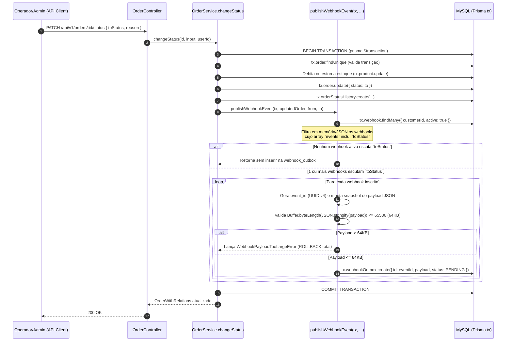
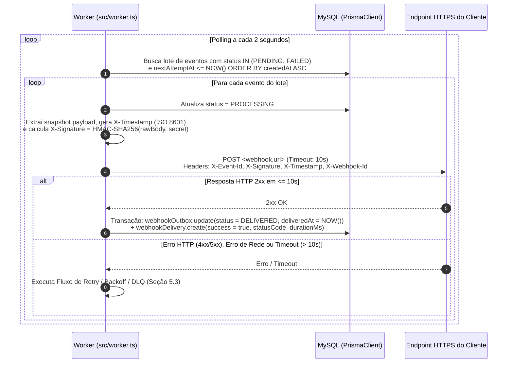
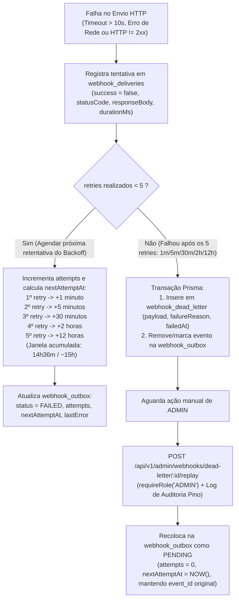

# FDD — Feature Design Document: Sistema de Webhooks de Notificação de Pedidos

| Metadado | Valor |
| :--- | :--- |
| **Feature** | Sistema de Webhooks de Notificação de Pedidos (*Outbound*) |
| **Documentos Base** | [PRD](./PRD.md), [RFC](./RFC.md), [ADR-001](./adrs/ADR-001-padrao-transactional-outbox-no-mysql.md), [ADR-002](./adrs/ADR-002-politica-de-retry-com-backoff-e-dlq.md), [ADR-003](./adrs/ADR-003-autenticacao-hmac-sha256-com-secret-por-endpoint.md), [ADR-004](./adrs/ADR-004-garantia-at-least-once-com-x-event-id.md), [ADR-005](./adrs/ADR-005-worker-em-processo-separado-com-polling.md), [ADR-006](./adrs/ADR-006-reuso-dos-padroes-arquiteturais-existentes.md) |
| **Stack Alvo** | Node.js `>=20` (ESM), TypeScript `5.6.3`, Express `4.21.1`, Prisma `5.22.0`, MySQL `8.0`, Zod `3.23.8`, Pino `9.5.0` (`package.json`) |
| **Prazo Estimado** | 3 Sprints (incluindo 2 dias úteis de revisão de segurança antes do deploy — `[09:46] Larissa`, `[09:46] Sofia`) |

---

## 1. Contexto e Motivação Técnica

O Order Management System (OMS) gerencia o ciclo de vida de pedidos (`PENDING`, `PAID`, `PROCESSING`, `SHIPPED`, `DELIVERED`, `CANCELLED`) com controle transacional de estoque e histórico de auditoria em `OrderService.changeStatus` (`src/modules/orders/order.service.ts`, linhas 126–179; `src/modules/orders/order.status.ts`, linhas 1–37), mas opera hoje sem nenhum mecanismo de notificação ativa, obrigando integradores externos a realizarem *polling* no endpoint `GET /api/v1/orders` (`[09:00] Marcos`, ver contexto de negócio no [PRD](./PRD.md) e [RFC](./RFC.md)).

Do ponto de vista de engenharia, o disparo da notificação HTTP não pode ocorrer de maneira síncrona dentro de `OrderService.changeStatus`, pois a transação SQL já atualiza `orders`, insere em `order_status_history` e debita/estorna `stock_quantity` em `products`. Uma chamada HTTP síncrona dentro dessa transação reteria locks no MySQL, degradaria o throughput de outros pedidos caso o endpoint do cliente estivesse lento e criaria inconsistência caso o servidor externo estivesse fora do ar (`[09:04] Bruno`, `[09:06] Diego`).

Este FDD especifica a implementação técnica do módulo de webhooks *outbound* utilizando o padrão **Transactional Outbox no MySQL**, processado por um **Worker em processo Node.js separado** via *polling* a cada 2 segundos.

---

## 2. Objetivos Técnicos

1. **Garantir Atomicidade Transacional (Zero Perda de Eventos):** Persistir o evento de webhook na tabela `webhook_outbox` dentro da mesma transação Prisma (`tx: Prisma.TransactionClient`) que altera o status do pedido em `OrderService.changeStatus`; se a gravação na outbox falhar, toda a mudança de status sofre rollback (`[09:06] Diego`, `[09:40] Bruno`, [ADR-001](./adrs/ADR-001-padrao-transactional-outbox-no-mysql.md)).
2. **Atender ao SLA de Latência (< 10 Segundos):** Processar eventos pendentes por meio de um worker em processo separado (`src/worker.ts`) com *polling* a cada **2 segundos** e timeout HTTP de **10 segundos** por tentativa (`[09:02] Marcos`, `[09:09] Diego`, `[09:10] Larissa`, `[09:42] Diego`, [ADR-005](./adrs/ADR-005-worker-em-processo-separado-com-polling.md)).
3. **Assegurar Resiliência a Indisponibilidades de Clientes (~15 Horas):** Implementar política de retry com até **5 tentativas** em *backoff* exponencial (`1m, 5m, 30m, 2h, 12h`), encaminhamento de falhas permanentes para a tabela isolada `webhook_dead_letter` e replay manual restrito à role `ADMIN` (`[09:15]–[09:19] Diego/Larissa`, `[09:36] Sofia/Larissa`, [ADR-002](./adrs/ADR-002-politica-de-retry-com-backoff-e-dlq.md)).
4. **Garantir Autenticidade, Integridade e Idempotência:** Assinar o payload com **HMAC-SHA256** (`X-Signature`) usando `secret` única por endpoint (com suporte a rotação e *grace period* de **24 horas**), exigir TLS (`https://`), limitar o payload a **64KB** e enviar `X-Event-Id` (`UUID`) para deduplicação *at-least-once* pelo cliente (`[09:20]–[09:26] Sofia/Diego/Larissa`, [ADR-003](./adrs/ADR-003-autenticacao-hmac-sha256-com-secret-por-endpoint.md), [ADR-004](./adrs/ADR-004-garantia-at-least-once-com-x-event-id.md)).
5. **Preservar Consistência Arquitetural com o OMS:** Estruturar o código em `src/modules/webhooks/` reutilizando `AppError` (com prefixo `WEBHOOK_*`), `errorMiddleware`, `validate` (Zod), `logger` (Pino) e `authenticate`/`requireRole` ([ADR-006](./adrs/ADR-006-reuso-dos-padroes-arquiteturais-existentes.md)).

---

## 3. Escopo e Exclusões

### 3.1 Escopo Incluso
- Modelagem Prisma e migração MySQL para configuração de webhooks, outbox (`webhook_outbox`), DLQ (`webhook_dead_letter`) e histórico de entregas (`[09:06] Diego`, `[09:18] Diego`, `[09:21] Bruno`, `[09:34] Marcos`).
- Integração transacional em `OrderService.changeStatus` via função pura `publishWebhookEvent(tx, order, fromStatus, toStatus)` com filtro de status e snapshot do payload JSON na inserção (`[09:34] Bruno`, `[09:40]–[09:41] Bruno/Diego`, `[09:52] Larissa`).
- Endpoints autenticados para CRUD de configuração de webhooks por cliente (`POST`, `GET`, `PATCH`, `DELETE`), rotação de secret com *grace period* de 24h e consulta das últimas 100 entregas (`GET /api/v1/webhooks/:id/deliveries`) (`[09:21] Sofia`, `[09:31]–[09:34] Marcos/Bruno/Larissa`).
- Endpoint administrativo `POST /api/v1/admin/webhooks/dead-letter/:id/replay` restrito a `requireRole('ADMIN')` com log de auditoria (`[09:18] Diego`, `[09:35]–[09:36] Diego/Sofia/Larissa`).
- Processo worker separado (`src/worker.ts` + script `"worker"` no `package.json`) com *polling* de 2s, assinatura HMAC-SHA256, timeout de 10s, backoff exponencial de 5 tentativas e movimentação para DLQ (`[09:09]–[09:18] Diego/Larissa`).

### 3.2 Exclusões (Fora de Escopo / Adiados)
- **Webhooks Inbound:** O sistema apenas envia notificações (*outbound*); não recebe webhooks externos (`[09:02]–[09:03] Marcos/Sofia`).
- **Expurgo/Arquivamento de Eventos Entregues (30 dias):** A rotina de arquivamento de linhas antigas da `webhook_outbox` após 30 dias está fora do escopo desta entrega (`[09:08] Diego`).
- **Múltiplos Workers em Paralelo e Ordenação Global:** A execução inicial é *single-worker* com ordenação implícita por `order_id` (`created_at`). Particionamento por `order_id` ou lock pessimista para múltiplos workers fica para o futuro (`[09:12]–[09:13] Diego/Larissa`).
- **Notificação por E-mail em Caso de Falhas Repetidas:** Alertas por e-mail ao cliente (ex.: após 3 falhas seguidas) ficaram para uma próxima fase (`[09:37]–[09:38] Marcos/Larissa`, `[09:48] Larissa`).
- **Rate Limiting de Saída por Cliente:** Não será implementado agora; o comportamento será observado em produção antes de qualquer decisão (`[09:38]–[09:39] Diego/Larissa`, `[09:48] Larissa`).
- **Dashboard / Painel Visual:** Apenas os endpoints HTTP serão construídos; qualquer interface gráfica pertence a um projeto futuro do time de frontend (`[09:39]–[09:40] Marcos/Larissa`, `[09:48] Larissa`).

---

## 4. Modelagem de Dados e Estrutura de Arquivos

### 4.1 Estrutura do Módulo Proposta
Seguindo estritamente os arquivos mencionados em `[09:27]–[09:28] Bruno/Diego` e o padrão de `src/modules/orders/` e `src/modules/customers/`:

```text
src/
├── worker.ts                                    # Novo entrypoint do processo Worker (npm run worker) — [09:11] Larissa, [09:28] Bruno
└── modules/
    └── webhooks/
        ├── webhook.routes.ts                    # Rotas /webhooks e /admin/webhooks — [09:27] Bruno
        ├── webhook.controller.ts                # Handlers Express (repasse a next(err)) — [09:27] Bruno
        ├── webhook.service.ts                   # CRUD, rotação de secret, deliveries e replay DLQ — [09:27] Bruno
        ├── webhook.repository.ts                # Queries Prisma das tabelas de webhook — [09:27] Bruno
        ├── webhook.schemas.ts                   # Schemas Zod (URL https://, enums OrderStatus, etc.) — [09:27] Bruno
        └── webhook.worker.ts                    # Lógica de processamento do worker (ou webhook.processor.ts) — [09:28] Bruno
```

> **Nota sobre `publishWebhookEvent` e Classes de Erro:**
> - A função pura `publishWebhookEvent(tx, order, fromStatus, toStatus)` acordada em `[09:41] Bruno/Diego` pode ser exportada a partir de `src/modules/webhooks/webhook.service.ts` (ou arquivo interno do módulo `src/modules/webhooks/`, **pendente de definição** na implementação).
> - As classes de erro com prefixo `WEBHOOK_*` (`[09:28] Bruno`, `[09:29] Larissa`) seguem o padrão real do repositório residindo em `src/shared/errors/http-errors.ts` e reexportadas em `src/shared/errors/index.ts`.

### 4.2 Especificação de Modelos no `prisma/schema.prisma`

> **Fronteira entre Decisões Fechadas na Reunião e Proposta de Modelagem Física (Pendente de Definição na Sprint 1):**
> Conforme `[09:46] Larissa` (*"Modelagem de outbox e DLQ é uma sprint"*), a reunião fechou os nomes literais das tabelas **`webhook_outbox`** (`[09:06] Diego`, `[09:40] Bruno`) e **`webhook_dead_letter`** (`[09:18] Diego`), o uso de chaves primárias **`UUID`** (`[09:51] Larissa`), os índices em **`status` (pendente, processando, falhou, entregue) e `created_at`** (`[09:08] Diego`), os atributos da configuração de webhook (`url + secret + customer_id + estado ativo` + lista de status em `[09:21] Bruno` e `[09:31] Marcos`), os atributos da DLQ (`payload, motivo da falha e timestamp` em `[09:18] Diego`) e os dados do histórico de entregas (`sucesso/falha, payload, response, tempo de resposta` em `[09:34] Marcos`).
> Os nomes físicos sugeridos abaixo para a tabela de configuração (`webhooks`), tabela de histórico (`webhook_deliveries`) e os nomes exatos de colunas auxiliares de controle (`previousSecret`, `previousSecretExpiresAt`, `attempts`, `nextAttemptAt`, `replayedById`) representam a **modelagem física proposta para a Sprint 1 (pendente de definição final no schema)**.

Os modelos abaixo seguem rigorosamente as convenções de `prisma/schema.prisma` (`@id @default(uuid()) @db.Char(36)`, `@@map("snake_case")` — `[09:51] Larissa`):

- **Enum `WebhookOutboxStatus`:** `PENDING`, `PROCESSING`, `FAILED`, `DELIVERED` (conforme estados listados em `[09:08] Diego`: *"pendente, processando, falhou, entregue"*).
- **Model `Webhook` (`@@map("webhooks")`):**
  - `id`: `String @id @default(uuid()) @db.Char(36)` (`[09:44] Sofia`, `[09:51] Larissa`)
  - `customerId`: `String @db.Char(36)` (FK para `Customer.id` — `[09:21] Bruno`)
  - `url`: `String @db.VarChar(2048)` (obrigatoriamente `https://` — `[09:21] Bruno`, `[09:23] Sofia`)
  - `secret`: `String @db.VarChar(255)` (secret ativa gerada pelo OMS — `[09:21] Sofia`, `[09:31] Marcos`)
  - `previousSecret`: `String? @db.VarChar(255)` (secret anterior durante rotação — `[09:21] Sofia`)
  - `previousSecretExpiresAt`: `DateTime?` (expiração de +24h da secret anterior — `[09:21] Sofia`)
  - `events`: `Json` (array de `OrderStatus` que o endpoint escuta, ex.: `["SHIPPED", "DELIVERED"]` — `[09:31] Marcos`, `[09:33] Marcos`)
  - `active`: `Boolean @default(true)` (estado ativo/inativo — `[09:21] Bruno`)
  - `createdAt` / `updatedAt`: `DateTime`
- **Model `WebhookOutbox` (`@@map("webhook_outbox")`):**
  - `id`: `String @id @default(uuid()) @db.Char(36)` (também utilizado como `event_id` / `X-Event-Id` — `[09:25] Diego`, `[09:51] Diego/Larissa`)
  - `webhookId`: `String @db.Char(36)` (FK para `Webhook.id`)
  - `orderId`: `String @db.Char(36)` (FK para `Order.id`)
  - `eventType`: `String @db.VarChar(64)` (`"order.status_changed"` — `[09:43] Diego`)
  - `payload`: `Json` (snapshot renderizado na inserção — `[09:51]–[09:52] Bruno/Larissa/Diego`)
  - `status`: `WebhookOutboxStatus @default(PENDING)` (`[09:08] Diego`)
  - `attempts`: `Int @default(0)` (contador de tentativas até o limite de 5 — `[09:15]–[09:17] Diego/Larissa`)
  - `nextAttemptAt`: `DateTime @default(now())` (controle do agendamento de backoff `1m/5m/30m/2h/12h` — `[09:17] Diego`)
  - `lastError`: `String? @db.Text`
  - `deliveredAt`: `DateTime?`
  - `createdAt` / `updatedAt`: `DateTime`
  - Índices obrigatórios: `@@index([status, nextAttemptAt, createdAt])` e `@@index([createdAt])` (`[09:08] Diego`: *"A tabela tem índice no campo de status (pendente, processando, falhou, entregue) e em created_at"*).
- **Model `WebhookDeadLetter` (`@@map("webhook_dead_letter")`):**
  - `id`: `String @id @default(uuid()) @db.Char(36)` (`[09:51] Larissa`)
  - `outboxId`: `String @db.Char(36)` (preserva o `event_id` original para idempotência no replay — `[09:18] Diego`, `[09:25] Diego`)
  - `webhookId`: `String @db.Char(36)` (FK para `Webhook.id`)
  - `orderId`: `String @db.Char(36)`
  - `payload`: `Json` (`[09:18] Diego`)
  - `failureReason`: `String @db.Text` (`[09:18] Diego`: *"com a payload, motivo da falha e timestamp"*)
  - `failedAt`: `DateTime @default(now())` (`[09:18] Diego`)
  - `replayedAt`: `DateTime?` / `replayedById`: `String? @db.Char(36)` (rastreabilidade do replay por `ADMIN` — `[09:36] Sofia`)
- **Model `WebhookDelivery` (`@@map("webhook_deliveries")`):**
  - `id`: `String @id @default(uuid()) @db.Char(36)`
  - `webhookId`: `String @db.Char(36)` (FK para `Webhook.id`)
  - `eventId`: `String @db.Char(36)`
  - `attemptNumber`: `Int`
  - `success`: `Boolean` (`[09:34] Marcos`)
  - `statusCode`: `Int?`
  - `requestPayload`: `Json` (`[09:34] Marcos`)
  - `responseBody`: `String? @db.Text` (`[09:34] Marcos`)
  - `durationMs`: `Int` (`[09:34] Marcos`: *"sucesso/falha, payload, response, tempo de resposta"*)
  - `createdAt`: `DateTime @default(now())`
  - Índice: `@@index([webhookId, createdAt])` para buscar rapidamente as últimas 100 entregas (`[09:34] Marcos`).

---

## 5. Fluxos Detalhados

### 5.1 Fluxo de Criação do Evento na Transactional Outbox

**Origem:** `[09:06] Diego`, `[09:24] Diego/Larissa`, `[09:33]–[09:34] Marcos/Bruno/Diego`, `[09:40]–[09:41] Bruno/Diego`, `[09:43] Diego`, `[09:51]–[09:52] Bruno/Larissa/Diego` e `src/modules/orders/order.service.ts` (linhas 126–179).



**Regras de Negócio Críticas na Criação:**
1. **Gatilho Exclusivo em `OrderService.changeStatus`:** Conforme definido em `[09:40] Bruno`, o ponto de disparo é o método `changeStatus` (`PATCH /api/v1/orders/:id/status`). A criação inicial do pedido (`OrderService.create`) não foi incluída como gatilho na reunião.
2. **Filtro na Inserção e Isolamento por Endpoint (`X-Webhook-Id`):** Se o cliente não tiver webhooks ativos ou nenhum deles estiver inscrito no novo status `toStatus`, nenhum registro é criado na `webhook_outbox` (`[09:34] Bruno`). Caso o cliente possua múltiplos webhooks ativos inscritos no mesmo `toStatus` (`[09:44] Sofia`), é inserida uma linha na `webhook_outbox` para cada endpoint inscrito, permitindo controle independente de entrega, retry e DLQ por endpoint.
3. **Snapshot Renderizado:** O payload é montado e persistido no momento da inserção na `webhook_outbox` (e não na hora do disparo pelo worker), garantindo que mutações posteriores no pedido não alterem o evento histórico (`[09:51]–[09:52] Bruno/Larissa/Diego`).
4. **Validação de Limite de 64KB:** Se o tamanho serializado do payload exceder 64KB (65.536 bytes), o sistema lança erro sem truncar o JSON (`[09:23] Sofia`, `[09:24] Diego/Larissa`).
5. **Atomicidade:** Qualquer falha ao inserir na `webhook_outbox` aborta a transação inteira de `OrderService.changeStatus` (`[09:40] Bruno`, `[09:41] Diego`).

---

### 5.2 Fluxo de Processamento pelo Worker

**Origem:** `[09:08]–[09:12] Diego/Larissa`, `[09:20]–[09:25] Sofia/Diego`, `[09:28]–[09:30] Bruno/Diego`, `[09:42]–[09:45] Diego/Sofia`.



> **Ponto Pendente de Definição (Batch Size):** Na reunião ficou decidido que o worker lê os eventos pendentes em *"batch pequeno"* (`[09:08] Diego`), mas o número exato de registros por ciclo não foi fixado verbalmente. Recomenda-se parametrizar via constante/variável de ambiente `WEBHOOK_WORKER_BATCH_SIZE` com valor padrão `20` (ou `50`), mantendo o item sinalizado como parâmetro ajustável.

---

### 5.3 Fluxo de Retry, Backoff Exponencial e Dead Letter Queue (DLQ)

**Origem:** `[09:14]–[09:19] Larissa/Diego/Bruno/Marcos`, `[09:35]–[09:36] Diego/Larissa/Sofia`.



**Detalhamento da Tabela de Backoff Exponencial (`[09:16]–[09:17] Diego/Larissa`):**

| Marco de Execução | Intervalo de Espera (`nextAttemptAt`) | Tempo Acumulado desde a 1ª Falha | Ação em Caso de Nova Falha | Origem |
| :--- | :---: | :---: | :--- | :--- |
| **Envio Inicial (0)** | Imediato (polling <= 2s) | `0m` | Agenda 1ª retentativa (`+1m`) | `[09:09] Diego`, `[09:17] Diego` |
| **1ª Retentativa** | `+1 minuto` | `1m` | Agenda 2ª retentativa (`+5m`) | `[09:17] Diego`, `[09:48] Larissa` |
| **2ª Retentativa** | `+5 minutos` | `6m` | Agenda 3ª retentativa (`+30m`) | `[09:17] Diego`, `[09:48] Larissa` |
| **3ª Retentativa** | `+30 minutos` | `36m` | Agenda 4ª retentativa (`+2h`) | `[09:17] Diego`, `[09:48] Larissa` |
| **4ª Retentativa** | `+2 horas` | `2h 36m` | Agenda 5ª retentativa (`+12h`) | `[09:17] Diego`, `[09:48] Larissa` |
| **5ª Retentativa** | `+12 horas` | **`14h 36m` (~15 horas)** | **Falha permanente:** move para `webhook_dead_letter` | `[09:15] Diego`, `[09:17] Diego`, `[09:18] Diego` |

> **Nota sobre Contagem de Tentativas (`attempts`):** Em `[09:17] Diego` (*"Eu pensei em 1 minuto, 5 minutos, 30 minutos, 2 horas, 12 horas. Total de quase 15 horas entre primeira falha e última tentativa"*) e `[09:48] Larissa` (*"Retry com backoff exponencial 1m/5m/30m/2h/12h, total 5 tentativas, depois DLQ"*), os 5 intervalos de espera somam exatamente 14h36m (~15h) após a primeira falha. O worker deve garantir que todos os 5 intervalos (`[1m, 5m, 30m, 2h, 12h]`) sejam executados antes de mover o evento para `webhook_dead_letter`.

---

## 6. Contratos Públicos HTTP e Payload de Eventos

Todos os endpoints da API seguem o prefixo `/api/v1` montado em `src/app.ts` (linha 67) e `src/routes/index.ts` (linhas 21–31), exigem o header `Authorization: Bearer <jwt_token>` validado por `authenticate` (`src/middlewares/auth.middleware.ts`, linha 27) e retornam o header `X-Request-Id` (`src/middlewares/request-logger.middleware.ts`, linha 8).

Como o token JWT atual (`JwtPayload` em `src/middlewares/auth.middleware.ts`, linhas 19–25) pertence ao usuário operador/admin (`sub`, `email`, `role`) e não carrega `customer_id`, o identificador do cliente é passado explicitamente no `body` ou `query`/`path` (`[09:32] Bruno/Marcos/Larissa`).

**Padrão de Schemas Zod (`src/modules/webhooks/webhook.schemas.ts`) e Envelope de Erro (`src/middlewares/error.middleware.ts`):**
- Reutilizando `z.nativeEnum(OrderStatus)` (como em `src/modules/orders/order.schemas.ts`, linhas 2 e 19) e o middleware `validate` (`src/middlewares/validate.middleware.ts`), todas as entradas de `params` (`id: z.string().uuid()`), `query` e `body` são validadas antes do controller (`[09:23] Sofia`, `[09:30] Larissa`).
- Para a validação de `url` com TLS obrigatório (`[09:23] Sofia`, `[09:28] Bruno`), caso a URL não inicie com `https://`, o sistema deve retornar HTTP `400` com código `WEBHOOK_INVALID_URL`.
- Qualquer erro lançado estendendo `AppError` é formatado por `src/middlewares/error.middleware.ts` (linhas 15–24) no envelope padrão:
```json
{
  "error": {
    "code": "WEBHOOK_INVALID_URL",
    "message": "Webhook URL must use https:// protocol"
  }
}
```

---

### 6.1 `POST /api/v1/webhooks` — Cadastrar Webhook

- **Origem:** `[09:21] Sofia/Bruno`, `[09:23] Sofia`, `[09:31] Marcos`, `[09:32] Larissa`, `[09:36]–[09:37] Marcos/Sofia`, `[09:44] Sofia`.
- **Autenticação / Role:** JWT obrigatório (`ADMIN` ou `OPERATOR`).
- **Semântica:** Cria uma nova configuração de webhook ativa para o `customerId` informado, valida que a `url` utiliza protocolo `https://`, que a lista de `events` contém valores válidos do enum `OrderStatus` e respeita o limite de até **5 webhooks ativos por customer** (`[09:44] Sofia`, `[09:45] Diego`). O OMS gera criptograficamente a `secret` exclusiva do endpoint e a retorna na criação.
- **Headers Request:** `Authorization: Bearer <token>`, `Content-Type: application/json`

**Request Body (JSON):**
```json
{
  "customerId": "550e8400-e29b-41d4-a716-446655440000",
  "url": "https://api.atlascomercial.com.br/webhooks/oms-orders",
  "events": ["PAID", "PROCESSING", "SHIPPED", "DELIVERED", "CANCELLED"],
  "active": true
}
```

**Response `201 Created` (JSON):**
```json
{
  "id": "7c9e6679-7425-40de-944b-e07fc1f90ae7",
  "customerId": "550e8400-e29b-41d4-a716-446655440000",
  "url": "https://api.atlascomercial.com.br/webhooks/oms-orders",
  "secret": "whsec_9f86d081884c7d659a2feaa0c55ad015a3bf4f1b2b0b822cd15d6c15b0f00a08",
  "events": ["PAID", "PROCESSING", "SHIPPED", "DELIVERED", "CANCELLED"],
  "active": true,
  "createdAt": "2026-10-26T12:30:00.000Z",
  "updatedAt": "2026-10-26T12:30:00.000Z"
}
```

**Status Codes:**
- `201 Created`: Webhook cadastrado com sucesso e `secret` gerada.
- `400 Bad Request`: Erro de validação de schema Zod ou URL sem `https://` (`WEBHOOK_INVALID_URL` / `VALIDATION_ERROR`).
- `401 Unauthorized`: Token JWT ausente ou inválido (`UNAUTHORIZED`).
- `404 Not Found`: `customerId` informado não existe na tabela `customers` (`NOT_FOUND`).

> **Nota (Pendente de Definição):** O formato literal da string da `secret` gerada (ex.: hex puro vs. prefixado com `whsec_`) e o envio opcional do campo `"active": true` no body de criação (dado que a tabela possui estado ativo por padrão conforme `[09:21] Bruno`) são ilustrativos no exemplo acima e estão pendentes de definição na implementação / revisão de segurança da Sofia (`[09:46] Sofia`).

---

### 6.2 `GET /api/v1/webhooks` — Listar Webhooks de um Cliente

- **Origem:** `[09:32] Larissa`, `[09:33] Bruno`, e padrão de listagem paginada com filtro `customerId` existente no código em `src/modules/orders/order.schemas.ts` (linhas 23–30) e `src/shared/http/response.ts` (linhas 22–24).
- **Autenticação / Role:** JWT obrigatório (`ADMIN` ou `OPERATOR`).
- **Semântica:** Lista os webhooks cadastrados filtrados por `customerId`.
  > **Nota (Pendente de Definição):** Na transcrição (`[09:32] Larissa`, `[09:33] Bruno`), foi definido que o `customer_id` pode ser passado no `body` ou no `path` (ou query, seguindo o padrão de `GET /api/v1/orders?customerId=...` do código). Além disso, se o campo `secret` será omitido/mascarado na listagem `GET` (já que é devolvido na criação conforme `[09:31] Marcos`) está **pendente de definição**.
- **Query Params:** `?customerId=550e8400-e29b-41d4-a716-446655440000&page=1&pageSize=20`

**Response `200 OK` (JSON):**
```json
{
  "data": [
    {
      "id": "7c9e6679-7425-40de-944b-e07fc1f90ae7",
      "customerId": "550e8400-e29b-41d4-a716-446655440000",
      "url": "https://api.atlascomercial.com.br/webhooks/oms-orders",
      "events": ["PAID", "PROCESSING", "SHIPPED", "DELIVERED", "CANCELLED"],
      "active": true,
      "createdAt": "2026-10-26T12:30:00.000Z",
      "updatedAt": "2026-10-26T12:30:00.000Z"
    }
  ],
  "pagination": {
    "page": 1,
    "pageSize": 20,
    "total": 1,
    "totalPages": 1
  }
}
```

**Status Codes:**
- `200 OK`: Lista paginada retornada com sucesso.
- `400 Bad Request`: Parâmetros de query inválidos (`VALIDATION_ERROR`).
- `401 Unauthorized`: Token JWT ausente ou inválido (`UNAUTHORIZED`).

---

### 6.3 `PATCH /api/v1/webhooks/:id` — Atualizar Configuração de Webhook

- **Origem:** `[09:21] Bruno`, `[09:23] Sofia`, `[09:33] Bruno`, `[09:33] Marcos`.
- **Autenticação / Role:** JWT obrigatório (`ADMIN` ou `OPERATOR`).
- **Semântica:** Atualiza parcialmente a `url` (validando `https://`), a lista de status `events` filtrados e/ou a flag `active` de um webhook existente.

**Request Body (JSON):**
```json
{
  "url": "https://integracoes.atlascomercial.com.br/v2/webhooks/orders",
  "events": ["SHIPPED", "DELIVERED"],
  "active": true
}
```

**Response `200 OK` (JSON):**
```json
{
  "id": "7c9e6679-7425-40de-944b-e07fc1f90ae7",
  "customerId": "550e8400-e29b-41d4-a716-446655440000",
  "url": "https://integracoes.atlascomercial.com.br/v2/webhooks/orders",
  "events": ["SHIPPED", "DELIVERED"],
  "active": true,
  "createdAt": "2026-10-26T12:30:00.000Z",
  "updatedAt": "2026-10-26T14:10:00.000Z"
}
```

**Status Codes:**
- `200 OK`: Webhook atualizado com sucesso.
- `400 Bad Request`: URL não utiliza `https://` (`WEBHOOK_INVALID_URL`) ou payload inválido (`VALIDATION_ERROR`).
- `401 Unauthorized`: Token JWT ausente ou inválido (`UNAUTHORIZED`).
- `404 Not Found`: Webhook não encontrado (`WEBHOOK_NOT_FOUND`).

---

### 6.4 `DELETE /api/v1/webhooks/:id` — Remover Webhook

- **Origem:** `[09:33] Bruno` e padrão de deleção HTTP `204 No Content` existente em `src/modules/customers/customer.controller.ts` (linhas 45–52) e `src/modules/orders/order.controller.ts` (linhas 48–55).
- **Autenticação / Role:** JWT obrigatório (`ADMIN` ou `OPERATOR`).
- **Semântica:** Remove o cadastro do endpoint de webhook.

**Request Body:** Vazio.

**Response `204 No Content`:** Corpo vazio.

**Status Codes:**
- `204 No Content`: Removido com sucesso.
- `401 Unauthorized`: Token JWT ausente ou inválido (`UNAUTHORIZED`).
- `404 Not Found`: Webhook não encontrado (`WEBHOOK_NOT_FOUND`).

---

### 6.5 `POST /api/v1/webhooks/:id/rotate-secret` — Rotacionar Secret com Grace Period de 24h

- **Origem:** `[09:21] Sofia`, `[09:22] Sofia`, `[09:48] Larissa`.
  > **Nota de Rastreabilidade (Pendente de Definição Literal do Path):** A existência do endpoint para rotação de secret com validade paralela de 24h é uma decisão confirmada (`[09:21] Sofia`: *"Endpoint pro cliente conseguir pedir nova secret pela API. Quando ele rotaciona, a antiga fica válida por 24 horas em paralelo"*), mas o sufixo literal da rota não foi soletrado na call. Adota-se `POST /api/v1/webhooks/:id/rotate-secret` seguindo o estilo de sub-recurso de ação do projeto (`PATCH /api/v1/orders/:id/status`), ficando o nome literal da rota sujeito a confirmação na revisão do PR.
- **Autenticação / Role:** JWT obrigatório (`ADMIN` ou `OPERATOR`).
- **Semântica:** Copia a `secret` atual para `previousSecret`, define `previousSecretExpiresAt = NOW() + 24 horas`, gera uma nova `secret` criptográfica principal e retorna a nova `secret` junto com o timestamp de expiração da chave anterior.

**Request Body:** Vazio (`{}`).

**Response `200 OK` (JSON):**
```json
{
  "id": "7c9e6679-7425-40de-944b-e07fc1f90ae7",
  "secret": "whsec_4a1b2c3d4e5f60718293a4b5c6d7e8f90123456789abcdef0123456789abcdef",
  "previousSecretValidUntil": "2026-10-27T14:20:00.000Z",
  "rotatedAt": "2026-10-26T14:20:00.000Z"
}
```

**Status Codes:**
- `200 OK`: Secret rotacionada com sucesso; chave antiga válida em paralelo por 24h.
- `401 Unauthorized`: Token JWT ausente ou inválido (`UNAUTHORIZED`).
- `404 Not Found`: Webhook não encontrado (`WEBHOOK_NOT_FOUND`).

---

### 6.6 `GET /api/v1/webhooks/:id/deliveries` — Histórico de Entregas do Webhook

- **Origem:** Literalmente definido em `[09:34] Marcos`: *"o cliente precisa conseguir ver o histórico de entregas. Tipo 'esses são os últimos 100 webhooks que vocês mandaram pra mim, sucesso/falha, payload, response, tempo de resposta'. GET /webhooks/:id/deliveries"*.
- **Autenticação / Role:** JWT obrigatório (`ADMIN` ou `OPERATOR`).
- **Semântica:** Retorna até os últimos **100 registros de tentativa de entrega** daquele webhook, ordenados do mais recente para o mais antigo (`createdAt DESC`), contendo indicador de sucesso/falha, status HTTP, payload enviado, resposta recebida e tempo de resposta em milissegundos.

**Response `200 OK` (JSON):**
```json
{
  "data": [
    {
      "id": "d290f1ee-6c54-4b01-90e6-d701748f0851",
      "webhookId": "7c9e6679-7425-40de-944b-e07fc1f90ae7",
      "eventId": "f47ac10b-58cc-4372-a567-0e02b2c3d479",
      "attemptNumber": 1,
      "success": true,
      "statusCode": 200,
      "requestPayload": {
        "event_id": "f47ac10b-58cc-4372-a567-0e02b2c3d479",
        "event_type": "order.status_changed",
        "timestamp": "2026-10-26T14:25:10.000Z",
        "order_id": "9b1deb4d-3b7d-4bad-9bdd-2b0d7b3dcb6d",
        "order_number": "ORD-000042",
        "from_status": "PROCESSING",
        "to_status": "SHIPPED",
        "customer_id": "550e8400-e29b-41d4-a716-446655440000",
        "total_cents": 459900
      },
      "responseBody": "{\"received\":true}",
      "durationMs": 142,
      "createdAt": "2026-10-26T14:25:12.150Z"
    }
  ]
}
```

**Status Codes:**
- `200 OK`: Histórico das últimas (até 100) entregas retornado com sucesso.
- `401 Unauthorized`: Token JWT ausente ou inválido (`UNAUTHORIZED`).
- `404 Not Found`: Webhook não encontrado (`WEBHOOK_NOT_FOUND`).

---

### 6.7 `POST /api/v1/admin/webhooks/dead-letter/:id/replay` — Replay Manual de DLQ (Admin)

- **Origem:** Literalmente definido em `[09:18] Diego`, `[09:35] Diego` (`POST /admin/webhooks/dead-letter/:id/replay`) e `[09:36] Sofia/Larissa` (role `ADMIN` obrigatório via `requireRole('ADMIN')` e log de auditoria).
- **Autenticação / Role:** JWT obrigatório + **`requireRole('ADMIN')`** (`src/middlewares/auth.middleware.ts`, linha 49). Operadores (`OPERATOR`) recebem `403 Forbidden`.
- **Semântica:** Localiza o registro na tabela `webhook_dead_letter` pelo `:id`, reinsere/reativa o evento na tabela `webhook_outbox` com `status = PENDING`, `attempts = 0` e `nextAttemptAt = NOW()` (preservando o `event_id` original para idempotência), marca o registro na DLQ como reprocessado e emite um log estruturado via Pino identificando `adminUserId: req.user.id` e `deadLetterId: id`.

**Request Body:** Vazio (`{}`).

**Response `200 OK` (JSON):**
```json
{
  "deadLetterId": "a1b2c3d4-e5f6-7890-abcd-ef1234567890",
  "outboxEventId": "f47ac10b-58cc-4372-a567-0e02b2c3d479",
  "status": "PENDING",
  "replayedBy": "11111111-2222-3333-4444-555555555555",
  "replayedAt": "2026-10-26T15:00:00.000Z"
}
```

**Status Codes:**
- `200 OK`: Evento reenfileirado na `webhook_outbox` como pendente.
- `401 Unauthorized`: Token JWT ausente ou inválido (`UNAUTHORIZED`).
- `403 Forbidden`: Usuário autenticado não possui role `ADMIN` (`FORBIDDEN`).
- `404 Not Found`: Registro não encontrado na DLQ (`WEBHOOK_DEAD_LETTER_NOT_FOUND`).

---

### 6.8 Contrato da Requisição HTTP Outbound (Enviada pelo Worker ao Cliente)

- **Origem:** `[09:20] Sofia`, `[09:25] Diego`, `[09:42] Diego`, `[09:43] Diego`, `[09:44] Diego/Sofia`, `[09:45] Diego`.
- **Método e URL:** `POST <webhook.url>` (obrigatoriamente `https://`)
- **Timeout:** `10000 ms` (10 segundos)
- **Limite de Payload:** Máximo `64 KB` (65.536 bytes)

**Headers HTTP Enviados pelo Worker:**
```http
POST /webhooks/oms-orders HTTP/1.1
Host: api.atlascomercial.com.br
Content-Type: application/json
X-Event-Id: f47ac10b-58cc-4372-a567-0e02b2c3d479
X-Webhook-Id: 7c9e6679-7425-40de-944b-e07fc1f90ae7
X-Timestamp: 2026-10-26T14:25:12.000Z
X-Signature: sha256=8f4e2a1b9c3d7e6f5a0b1c2d3e4f5a6b7c8d9e0f1a2b3c4d5e6f7a8b9c0d1e2f
```

> **Detalhe Técnico sobre `X-Signature` e Grace Period de 24h (Pendente de Definição / Revisão de Segurança):**
> Conforme acordado em `[09:20]–[09:22] Sofia` e `[09:46] Sofia`, a assinatura é calculada com `HMAC-SHA256` sobre o corpo da requisição, e quando a secret é rotacionada a antiga permanece válida por 24 horas em paralelo. Tanto a convenção de formatação da string em `X-Signature` (ex.: digest hexadecimal puro vs. prefixo ilustrativo `sha256=`) quanto o modo de envio da assinatura durante a janela de 24h em que a secret anterior ainda é válida passarão pela definição e revisão de código de 2 dias úteis reservada para Sofia (`[09:46] Sofia`).

**Payload JSON Enviado (Enxuto, Sem `items` — `[09:43] Diego`):**
```json
{
  "event_id": "f47ac10b-58cc-4372-a567-0e02b2c3d479",
  "event_type": "order.status_changed",
  "timestamp": "2026-10-26T14:25:10.000Z",
  "order_id": "9b1deb4d-3b7d-4bad-9bdd-2b0d7b3dcb6d",
  "order_number": "ORD-000042",
  "from_status": "PROCESSING",
  "to_status": "SHIPPED",
  "customer_id": "550e8400-e29b-41d4-a716-446655440000",
  "total_cents": 459900
}
```

> **Nota sobre "Campos Básicos da Order" (Pendente de Definição):** Em `[09:43] Diego`, foram nominalmente citados `event_id`, `event_type` (`"order.status_changed"`), `timestamp` (ISO 8601), `order_id`, `order_number`, `from_status`, `to_status`, `customer_id` e *"os campos básicos da order tipo total_cents. Não manda items pra não inflar"*. A inclusão eventual de outros campos escalares existentes no model `Order` (`subtotalCents`, `discountCents`, `notes` em `prisma/schema.prisma`) está **pendente de definição**.

---

## 7. Matriz de Erros (`WEBHOOK_*`)

Conforme definido em `[09:28] Bruno` e `[09:29] Larissa` (*"Prefixo WEBHOOK_ pra tudo do módulo"*), todos os erros de domínio estendem `AppError` (`src/shared/errors/app-error.ts`) e são serializados pelo `errorMiddleware` (`src/middlewares/error.middleware.ts`) no formato `{ error: { code, message, details? } }`:

| Código de Erro (`errorCode`) | Status HTTP | Classe Base (`http-errors.ts`) | Condição de Disparo | Origem (Transcrição / Código) |
| :--- | :---: | :--- | :--- | :--- |
| `WEBHOOK_NOT_FOUND` | `404` | `AppError` / `NotFoundError` | Webhook com o `:id` informado não existe no banco de dados. | Literalmente citado em `[09:28] Bruno` |
| `WEBHOOK_INVALID_URL` | `400` | `BadRequestError` / `ValidationError` | URL cadastrada ou editada não é uma URL válida ou não utiliza protocolo `https://` (ex.: `http://`). | Literalmente citado em `[09:28] Bruno` + regra TLS em `[09:23] Sofia` |
| `WEBHOOK_SECRET_REQUIRED` | `400` / `422` | `BadRequestError` / `UnprocessableEntityError` | Operação de assinatura ou configuração sem `secret` presente/válida. | Literalmente citado em `[09:28] Bruno` |
| `WEBHOOK_PAYLOAD_TOO_LARGE` | `422` | `UnprocessableEntityError` | O snapshot do payload JSON do evento excede o limite máximo de **64KB** (65.536 bytes). Não trunca e aborta a operação. | Comportamento definido em `[09:23] Sofia` e `[09:24] Diego/Larissa` + regra de prefixo `[09:29] Larissa` *(nome exato do código derivado da regra `WEBHOOK_`)* |
| `WEBHOOK_DEAD_LETTER_NOT_FOUND` | `404` | `AppError` / `NotFoundError` | O `:id` informado em `POST /api/v1/admin/webhooks/dead-letter/:id/replay` não existe na tabela `webhook_dead_letter`. | Fluxo de replay em `[09:18] Diego` e `[09:35] Diego` + regra de prefixo `[09:29] Larissa` *(nome exato do código derivado da regra `WEBHOOK_`)* |
| `WEBHOOK_DEAD_LETTER_ALREADY_REPLAYED` | `409` | `ConflictError` | Tentativa de acionar replay em um registro da DLQ que já foi reprocessado anteriormente. | Padrão de `ConflictError` em `src/shared/errors/http-errors.ts` + `[09:29] Larissa` *(pendente de definição se será permitido múltiplos replays ou bloqueado com 409)* |
| `WEBHOOK_LIMIT_EXCEEDED` | `422` / `409` | `UnprocessableEntityError` / `ConflictError` | Tentativa de criar ou ativar mais de **5 webhooks ativos** para o mesmo `customerId`. | Limite mencionado em `[09:44] Sofia` e confirmado em `[09:45] Diego` + regra de prefixo `[09:29] Larissa` *(nome exato do código derivado da regra `WEBHOOK_`)* |

---

## 8. Estratégias de Resiliência

1. **Desacoplamento Transacional via Outbox (`[09:04] Bruno`, `[09:06] Diego`):** A API nunca realiza chamadas HTTP externas durante `PATCH /api/v1/orders/:id/status`. Se o servidor do cliente estiver lento ou offline, a API do OMS permanece 100% disponível e rápida.
2. **Isolamento de Processo SO (`[09:11] Diego/Larissa`):** O worker roda em processo separado (`src/worker.ts`). Quedas, reinicializações ou deploys da API não interrompem o ciclo de vida do worker e vice-versa.
3. **Timeout Estrito de 10 Segundos (`[09:42] Sofia/Diego`):** Toda chamada HTTP do worker utiliza `AbortController` / `AbortSignal.timeout(10_000)` para encerrar conexões pendentes após 10 segundos e agendar retry, impedindo exaustão de sockets/threads.
4. **Backoff Exponencial de 5 Tentativas (~15 Horas) (`[09:15]–[09:17] Diego/Larissa`):** Intervalos de `1m -> 5m -> 30m -> 2h -> 12h` absorvem tanto falhas momentâneas de rede quanto janelas de manutenção planejada de clientes (como manutenções de 2 horas relatadas em produção).
5. **Isolamento de Poison Messages em DLQ e Replay Manual (`[09:18] Diego`):** Após esgotar as 5 tentativas de retry, o evento sai da `webhook_outbox` e vai para `webhook_dead_letter`, evitando que endpoints quebrados degradem o polling dos demais clientes. O fallback operacional é o replay manual via endpoint `POST /api/v1/admin/webhooks/dead-letter/:id/replay` após o cliente normalizar seu ambiente (visto que fallback por e-mail foi excluído desta fase em `[09:37] Larissa`).
6. **Rotação de Secret com Grace Period de 24h (`[09:21] Sofia`):** Evita falha de autenticação de webhooks em trânsito enquanto o cliente atualiza suas variáveis de ambiente após uma rotação de credencial.
7. **Graceful Shutdown no Worker (`src/server.ts`, linhas 13–22):** Ao receber `SIGINT` ou `SIGTERM`, o `src/worker.ts` interrompe o agendamento do próximo ciclo de polling de 2s, aguarda a conclusão do lote HTTP em andamento e executa `await prisma.$disconnect()` antes de encerrar o processo.

---

## 9. Integração com o Sistema Existente (Seção Obrigatória)

Abaixo estão os **8 arquivos reais do código base** que serão estendidos ou reutilizados diretamente pelo módulo de webhooks:

### 9.1 [`src/modules/orders/order.service.ts`](../src/modules/orders/order.service.ts#L126-L179)
- **Situação Atual:** O método `OrderService.changeStatus(id, input, userId)` abre `this.prisma.$transaction(async (tx) => { ... })`, busca o pedido na linha 132 (`const order = await tx.order.findUnique({ where: { id }, include: { items: true } })`), valida a transição com `canTransition(from, to)`, debita/estorna estoque (`this.debitStock` / `this.replenishStock`), executa `tx.order.update` (linha 158) e `tx.orderStatusHistory.create` (linhas 159–167), retornando o pedido atualizado.
- **Como Será Integrado:** Imediatamente após `tx.orderStatusHistory.create` (linha 167) e antes de `tx.order.findUnique` (linha 169), será invocada a função pura `await publishWebhookEvent(tx, order, from, to)` (`[09:40] Bruno`, `[09:41] Bruno/Diego`):
```typescript
// Trecho de integração em src/modules/orders/order.service.ts (linhas 158-170):
await tx.order.update({ where: { id }, data: { status: to } });
await tx.orderStatusHistory.create({
  data: {
    orderId: id,
    fromStatus: from,
    toStatus: to,
    changedById: userId,
    reason: input.reason ?? null,
  },
});

await publishWebhookEvent(tx, order, from, to);
```
- O objeto `order` já carregado na linha 132 contém todos os atributos escalares necessários para montar o snapshot do payload (`id`, `orderNumber`, `customerId`, `totalCents`), evitando consulta extra à tabela `orders`. Como `tx` (`Prisma.TransactionClient`, definido na linha 24 como `type TxClient = Prisma.TransactionClient`) é compartilhado, a consulta de webhooks ativos do `order.customerId` inscritos em `to` e o insert em `webhook_outbox` participam da mesma transação ACID do MySQL (`[09:06] Diego`, `[09:34] Bruno`, `[09:40] Bruno`).

### 9.2 [`prisma/schema.prisma`](../prisma/schema.prisma#L40-L97)
- **Situação Atual:** Define os enums `UserRole` e `OrderStatus` e os models `User`, `Customer`, `Product`, `Order`, `OrderItem`, `OrderStatusHistory` e `OrderNumberSequence`.
- **Como Será Integrado:**
  1. No model `Customer` (linhas 40–54), adicionar a relação `webhooks Webhook[]`.
  2. No model `Order` (linhas 74–97), adicionar a relação `webhookOutboxEvents WebhookOutbox[]`.
  3. Adicionar o enum `WebhookOutboxStatus` e os models `Webhook` (`@@map("webhooks")`), `WebhookOutbox` (`@@map("webhook_outbox")`), `WebhookDeadLetter` (`@@map("webhook_dead_letter")`) e `WebhookDelivery` (`@@map("webhook_deliveries")`), todos usando `@id @default(uuid()) @db.Char(36)` (`[09:06] Diego`, `[09:18] Diego`, `[09:21] Bruno`, `[09:34] Marcos`, `[09:51] Larissa`).

### 9.3 [`src/shared/errors/http-errors.ts`](../src/shared/errors/http-errors.ts#L1-L63) e [`src/shared/errors/index.ts`](../src/shared/errors/index.ts#L1-L13)
- **Situação Atual:** Define as subclasses de [`AppError`](../src/shared/errors/app-error.ts#L3-L16), incluindo erros de domínio como `InvalidStatusTransitionError` (`INVALID_STATUS_TRANSITION`) e `InsufficientStockError` (`INSUFFICIENT_STOCK`).
- **Como Será Integrado:** As novas classes de erro do domínio de webhooks estenderão `AppError` (ou `BadRequestError`, `NotFoundError`, `UnprocessableEntityError`) em `src/shared/errors/http-errors.ts` e serão reexportadas em `src/shared/errors/index.ts` com códigos prefixados por `WEBHOOK_*`, sendo automaticamente interceptadas pelo [`errorMiddleware`](../src/middlewares/error.middleware.ts#L14-L24) sem qualquer alteração neste middleware (`[09:28] Bruno`, `[09:29] Larissa/Bruno`).

### 9.4 [`src/middlewares/auth.middleware.ts`](../src/middlewares/auth.middleware.ts#L27-L61)
- **Situação Atual:** Exporta os middlewares `authenticate` (valida Bearer JWT e popula `req.user = { id, email, role }`) e `requireRole(...roles)` (retorna `403 ForbiddenError` se `req.user.role` não estiver autorizado, como já usado em `src/modules/users/user.routes.ts`, linha 15).
- **Como Será Integrado:**
  1. Nas rotas de configuração e histórico (`/api/v1/webhooks/*`), aplicar `router.use(authenticate)` (`[09:32] Larissa`, `[09:37] Sofia`).
  2. Na rota administrativa `POST /api/v1/admin/webhooks/dead-letter/:id/replay`, aplicar `authenticate, requireRole('ADMIN')` e utilizar `req.user.id` para registrar quem executou o replay no log de auditoria (`[09:36] Sofia/Larissa`).

### 9.5 [`src/app.ts`](../src/app.ts#L26-L68) e [`src/routes/index.ts`](../src/routes/index.ts#L13-L31)
- **Situação Atual:** `buildControllers(prisma)` em `src/app.ts` instancia os repositórios, serviços e controllers de `auth`, `users`, `customers`, `products` e `orders`, passando-os para `buildApiRouter(controllers)` em `src/routes/index.ts`.
- **Como Será Integrado:**
  1. Em `src/app.ts`, instanciar `WebhookRepository(prisma)`, `WebhookService(webhookRepository, prisma)` e `WebhookController(webhookService)` dentro de `buildControllers` e incluí-los no objeto `Controllers` retornado.
  2. Em `src/routes/index.ts`, estender o tipo `Controllers` com `webhooks: WebhookController` e montar `router.use('/webhooks', buildWebhookRouter(controllers.webhooks))` e `router.use('/admin/webhooks', buildAdminWebhookRouter(controllers.webhooks))` (`[09:27] Bruno`, `[09:35] Diego`).

### 9.6 [`src/config/database.ts`](../src/config/database.ts#L1-L10), [`src/server.ts`](../src/server.ts#L1-L27) e [`package.json`](../package.json#L10-L21)
- **Situação Atual:** `src/config/database.ts` exporta `createPrismaClient()` e a instância `prisma`; `src/server.ts` inicializa o servidor Express e registra handlers `SIGINT`/`SIGTERM`; `package.json` define os scripts `dev`, `build` e `start`.
- **Como Será Integrado:**
  1. Criar `src/worker.ts` seguindo a estrutura de `src/server.ts`, importando `createPrismaClient()` (ou `prisma` de `src/config/database.ts`, que em um processo SO separado cria uma nova instância de `PrismaClient` apontando para a mesma `DATABASE_URL`) e iniciando o loop de polling de 2 segundos (`[09:11] Diego/Larissa`, `[09:28] Bruno`, `[09:30] Bruno`).
  2. Adicionar em `package.json` os scripts `"worker": "node --env-file=.env dist/worker.js"` e `"dev:worker": "tsx watch --env-file=.env src/worker.ts"` (`[09:11] Larissa`).

### 9.7 [`src/shared/logger/index.ts`](../src/shared/logger/index.ts#L1-L32)
- **Situação Atual:** Configura o logger global Pino com `redactPaths` (`req.headers.authorization`, `*.password`, `*.token`, etc.).
- **Como Será Integrado:** Reutilizado pelo módulo de webhooks e pelo processo `src/worker.ts`, inclusive para gravar o log de auditoria quando um usuário `ADMIN` executar o replay da DLQ (`[09:29] Bruno`, `[09:36] Sofia`). Como recomendação técnica alinhada ao padrão de `redactPaths` existente em `src/shared/logger/index.ts` (linhas 4–11), sugere-se incluir `*.secret` na configuração de redaction para evitar exposição acidental nos logs internos do OMS (complementando a proteção contra vazamentos em logs do cliente mencionada em `[09:22] Diego`).

### 9.8 [`src/middlewares/validate.middleware.ts`](../src/middlewares/validate.middleware.ts#L11-L37) e [`src/middlewares/error.middleware.ts`](../src/middlewares/error.middleware.ts#L14-L65)
- **Situação Atual:** `validate` executa `.parse()` nos schemas Zod de `body`, `query` e `params`, convertendo `ZodError` em `ValidationError` (`400 VALIDATION_ERROR`). O `errorMiddleware` serializa qualquer `AppError` com seu `statusCode`, `errorCode` e `details`, além de mapear erros conhecidos do Prisma (`P2002` -> `409 CONFLICT`, `P2025` -> `404 NOT_FOUND`).
- **Como Será Integrado:** Todas as rotas em `src/modules/webhooks/webhook.routes.ts` utilizarão `validate({ body, query, params })` com os schemas de `webhook.schemas.ts`, e o `WebhookService` verificará a existência de `Customer` no cadastro (lançando `new NotFoundError('Customer')`, igual a `src/modules/orders/order.service.ts` na linha 60) e lançará as subclasses de `AppError` com códigos `WEBHOOK_*`, que serão tratadas por `errorMiddleware` sem necessidade de alterar nenhum dos dois middlewares (`[09:23] Sofia`, `[09:28]–[09:30] Bruno/Larissa`).

---

## 10. Observabilidade (Métricas, Logs e Tracing)

> **Nota de Rastreabilidade:** Na transcrição foram decididos o reuso do logger **Pino** existente (`[09:29] Bruno`), a obrigatoriedade de **logar quem fez o replay da DLQ para auditoria** (`[09:36] Sofia`), o registro de **sucesso/falha, payload, response e tempo de resposta** nas entregas (`[09:34] Marcos`) e o envio de **`X-Event-Id`** (`[09:25] Diego`). Os nomes específicos das chaves de evento de log e dos indicadores de métricas abaixo são **sugestões de implementação (pendentes de definição final no código)** para compor a estratégia de observabilidade.

### 10.1 Logs Estruturados (Pino — `src/shared/logger/index.ts`)
Reutilizando a instância `logger` existente (`[09:29] Bruno`, `[09:36] Sofia`):
- **API HTTP:** Já coberta automaticamente por `requestLogger` (`src/middlewares/request-logger.middleware.ts`), emitindo `http_request` com `requestId`, `method`, `path`, `statusCode`, `durationMs` e `userId`.
- **Auditoria de Replay de DLQ (Obrigatório — `[09:36] Sofia`):** Registrar o identificador do administrador (`req.user.id`) e o evento reprocessado ao executar `POST /api/v1/admin/webhooks/dead-letter/:id/replay`.
- **Eventos de Ciclo de Vida do Worker (`src/worker.ts` — Nomenclatura sugerida / pendente de definição):**
  - Inicialização e encerramento do worker (seguindo `server_started` / `shutdown_initiated` de `src/server.ts`).
  - Sucesso, falha/agendamento de retry e movimentação para `webhook_dead_letter`.

### 10.2 Métricas Operacionais (Proposta de Monitoramento — Pendente de Definição de Ferramental)
Com base nos dados já persistidos no banco de dados (`webhook_outbox`, `webhook_dead_letter` e histórico de entregas de `[09:34] Marcos`), os seguintes indicadores permitem monitorar o SLA de < 10s (`[09:02] Marcos`), o acúmulo na outbox (`[09:07]–[09:08] Bruno/Diego`) e a observação futura sobre rate limiting de saída (`[09:38]–[09:39] Diego/Larissa`):
- **Eventos pendentes na `webhook_outbox`:** Contagem de linhas com `status = PENDING`.
- **Tempo de resposta do endpoint do cliente (`durationMs`):** Medido em cada tentativa de entrega (`[09:34] Marcos`).
- **Latência ponta a ponta de notificação:** Intervalo entre `created_at` do evento na outbox e a entrega efetiva (meta < 10s — `[09:02] Marcos`).
- **Volume de sucessos, retries e entradas na `webhook_dead_letter`.**

### 10.3 Tracing e Correlação Distribuída
- **Dentro da API:** O middleware `requestLogger` (`src/middlewares/request-logger.middleware.ts`, linhas 6–8) gera ou propaga `X-Request-Id`.
- **Da Outbox até o Cliente Externo:** O `event_id` (`UUID` gerado na criação do registro na `webhook_outbox` — `[09:25] Diego`) atua como *correlation ID* transversal entre a transação original do pedido, os logs do worker, a tabela `webhook_deliveries`, a tabela `webhook_dead_letter` e a chamada HTTP externa enviada com os headers `X-Event-Id` e `X-Webhook-Id` (`[09:44] Diego/Sofia`).

---

## 11. Dependências e Compatibilidade

- **Zero Novas Dependências Externas de Runtime:**
  - **Criptografia HMAC e Geração de Secret:** Utiliza o módulo nativo `node:crypto` do Node.js 20 (`crypto.createHmac('sha256', secret)` e `crypto.randomBytes(32).toString('hex')`).
  - **Cliente HTTP do Worker:** Utiliza a API nativa `fetch` + `AbortSignal.timeout(10_000)` do Node.js `>=20` (`package.json`, linha 8).
  - **UUID, Validação, ORM e Logs:** Reutiliza `uuid` (`11.0.3`), `zod` (`3.23.8`), `@prisma/client` (`5.22.0`) e `pino` (`9.5.0`) já instalados no `package.json` (`[09:29]–[09:30] Bruno/Larissa`).
- **Compatibilidade com Banco de Dados e API:**
  - As alterações no `prisma/schema.prisma` são puramente aditivas (novas tabelas e relações opcionais em `Customer` e `Order`), mantendo 100% de retrocompatibilidade com os endpoints e testes existentes (`tests/auth.test.ts`, `tests/orders.test.ts`).

---

## 12. Critérios de Aceite Técnicos

1. **Atomicidade da Outbox:** Ao chamar `PATCH /api/v1/orders/:id/status` para um status assinado por um webhook ativo do cliente, o registro em `webhook_outbox` é criado na mesma transação com o snapshot do payload JSON; se a inserção na outbox falhar, o status do pedido em `orders` e `order_status_history` não é alterado (`[09:06] Diego`, `[09:40] Bruno`, `[09:52] Larissa`).
2. **Filtro na Inserção:** Se o cliente não possuir webhook ativo ou se o `toStatus` não estiver na lista de eventos do webhook, nenhuma linha é inserida na `webhook_outbox` (`[09:34] Bruno`).
3. **Validação de URL e Limite de Payload:** Tentativas de cadastrar/atualizar webhook com URL `http://` retornam `400` (`WEBHOOK_INVALID_URL`); eventos cujo payload serializado exceda `64KB` falham com `WEBHOOK_PAYLOAD_TOO_LARGE` sem truncar o JSON (`[09:23]–[09:24] Sofia/Diego/Larissa`, `[09:28] Bruno`).
4. **Worker e Headers Outbound:** O processo `src/worker.ts` lê pendentes a cada 2s e envia `POST` JSON (sem `items`) com timeout de 10s e os headers `Content-Type: application/json`, `X-Event-Id`, `X-Signature` (HMAC-SHA256 válido), `X-Timestamp` e `X-Webhook-Id` (`[09:09] Diego`, `[09:20] Sofia`, `[09:42]–[09:45] Diego/Sofia`).
5. **Política de Retry e DLQ:** Falhas consecutivas agendam `nextAttemptAt` exatamente em `1m, 5m, 30m, 2h e 12h`. Após esgotar as 5 tentativas de retry sem sucesso, o evento é movido para `webhook_dead_letter` com payload, motivo e timestamp (`[09:15]–[09:18] Diego/Larissa`).
6. **Replay Admin e RBAC:** `POST /api/v1/admin/webhooks/dead-letter/:id/replay` retorna `403 Forbidden` para `OPERATOR`, permite que `ADMIN` reenfileire o evento na `webhook_outbox` como `PENDING` e registra log de auditoria no Pino (`[09:18] Diego`, `[09:35]–[09:36] Diego/Sofia/Larissa`).
7. **Rotação de Secret e Histórico de Entregas:** A rotação gera nova secret mantendo a anterior válida por 24h; `GET /api/v1/webhooks/:id/deliveries` retorna até as últimas 100 entregas com sucesso/falha, payload, response e `durationMs` (`[09:21] Sofia`, `[09:34] Marcos`).

---

## 13. Riscos Técnicos e Mitigação

| Risco Técnico | Impacto | Estratégia de Mitigação na Implementação | Origem |
| :--- | :--- | :--- | :--- |
| **Degradação de performance na query de polling da `webhook_outbox`** | Médio | Índice composto em `(status, nextAttemptAt, createdAt)`, filtragem de eventos na inserção, leitura em lotes pequenos e remoção de falhas definitivas para `webhook_dead_letter`. | `[09:08] Diego`, `[09:18] Diego`, `[09:34] Bruno` |
| **Sockets presos no Worker por endpoints externos lentos** | Alto | Uso obrigatório de timeout HTTP de **10 segundos** (`AbortSignal.timeout(10000)`) em todas as requisições do worker e execução em processo separado da API (`src/worker.ts`). | `[09:11] Diego`, `[09:42] Diego/Sofia` |
| **Exposição acidental de `secret` em logs** | Alto | Inclusão de `*.secret` e `*.previousSecret` no `redactPaths` de `src/shared/logger/index.ts`, não retorno da secret em texto aberto na listagem e revisão de segurança de 2 dias úteis antes do deploy. | `[09:22] Diego`, `[09:46] Sofia`, `src/shared/logger/index.ts` |
| **Concorrência / Eventos fora de ordem se mais de um worker for iniciado acidentalmente** | Médio | Operação estrita em topologia *single-worker* nesta fase e atualização atômica do status do lote para `PROCESSING` ao capturar eventos da outbox. | `[09:08] Diego`, `[09:12]–[09:13] Diego/Larissa` |
| **Rajada de eventos de um mesmo cliente sobrecarregar o receptor** | Baixo / Médio | Monitoramento via logs/métricas de entregas por `webhookId`; *rate limiting* de saída registrado para observação em produção e decisão futura caso ocorra. | `[09:38]–[09:39] Diego/Larissa` |
