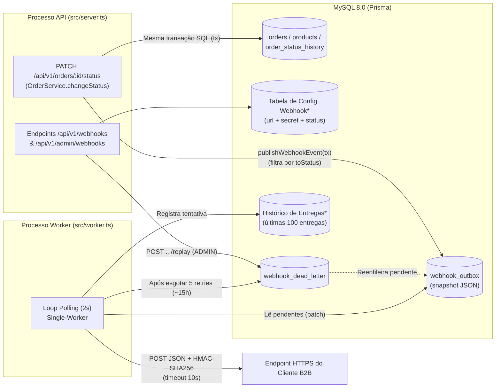

# RFC: Sistema de Webhooks de Notificação de Pedidos (Outbound)

| Campo | Valor |
| :--- | :--- |
| **Autora** | Larissa (Tech Lead) (`[09:00] Larissa`, `[09:50] Larissa`) |
| **Status** | Em Revisão (Submetido à equipe para revisão técnica antes do início da implementação — `[09:50] Larissa`) |
| **Data** | 2026-10-26 |
| **Revisores** | Diego (Engenheiro Sênior — Plataforma), Bruno (Engenheiro Pleno — Pedidos), Sofia (Engenheira de Segurança), Marcos (Product Manager) (`[09:49]–[09:50]`) |
| **Estimativa de Entrega** | 3 Sprints (incluindo janela mínima de 2 dias úteis para revisão de segurança antes do deploy — `[09:46] Larissa`, `[09:46] Sofia`) |
| **Documentos Relacionados** | [PRD](./PRD.md) · [FDD](./FDD.md) · [ADR-001](./adrs/ADR-001-padrao-transactional-outbox-no-mysql.md) · [ADR-002](./adrs/ADR-002-politica-de-retry-com-backoff-e-dlq.md) · [ADR-003](./adrs/ADR-003-autenticacao-hmac-sha256-com-secret-por-endpoint.md) · [ADR-004](./adrs/ADR-004-garantia-at-least-once-com-x-event-id.md) · [ADR-005](./adrs/ADR-005-worker-em-processo-separado-com-polling.md) · [ADR-006](./adrs/ADR-006-reuso-dos-padroes-arquiteturais-existentes.md) |

---

## 1. Resumo Executivo (TL;DR)

Este RFC propõe a arquitetura para o **Sistema de Webhooks de Notificação de Pedidos (*Outbound*)** do Order Management System (OMS). A solução substitui o modelo atual — no qual clientes B2B consultam repetidamente `GET /api/v1/orders` — por notificações HTTP `POST` assíncronas disparadas sempre que o status de um pedido muda (`[09:00] Marcos`, `[09:02] Marcos`, `[09:03] Sofia`).

A arquitetura proposta baseia-se em seis pilares alinhados na reunião técnica (`[09:48] Larissa`):
1. **Transactional Outbox no MySQL (`webhook_outbox`):** Gravação atômica do snapshot do evento na mesma transação SQL de `OrderService.changeStatus` (`src/modules/orders/order.service.ts`), filtrando na inserção apenas os status assinados pelos webhooks ativos do cliente ([ADR-001](./adrs/ADR-001-padrao-transactional-outbox-no-mysql.md)).
2. **Worker Independente em Polling (2s):** Processo Node.js separado (`src/worker.ts`) lendo eventos pendentes a cada 2 segundos, cumprindo com folga o SLA de latência inferior a 10 segundos sem introduzir novos brokers de mensageria ([ADR-005](./adrs/ADR-005-worker-em-processo-separado-com-polling.md)).
3. **Resiliência com Backoff Exponencial e DLQ:** Timeout de 10s por chamada HTTP, até 5 tentativas de retry (`1m, 5m, 30m, 2h, 12h`, cobrindo ~15h) e isolamento de falhas permanentes na tabela `webhook_dead_letter`, com endpoint administrativo (`ADMIN`) para replay manual ([ADR-002](./adrs/ADR-002-politica-de-retry-com-backoff-e-dlq.md)).
4. **Segurança Criptográfica e Transporte:** TLS obrigatório (`https://`), assinatura `HMAC-SHA256` (`X-Signature`) com `secret` única por endpoint e suporte a rotação de secret com *grace period* de 24 horas ([ADR-003](./adrs/ADR-003-autenticacao-hmac-sha256-com-secret-por-endpoint.md)).
5. **Entrega *At-Least-Once* e Idempotência:** Envio de identificador único `UUID` no header `X-Event-Id` (e `event_id` no payload) para deduplicação no cliente ([ADR-004](./adrs/ADR-004-garantia-at-least-once-com-x-event-id.md)).
6. **Reuso Arquitetural:** Novo módulo `src/modules/webhooks` seguindo integralmente os padrões do projeto (`AppError` com prefixo `WEBHOOK_*`, `errorMiddleware`, `validate` com Zod, logger `Pino` e middlewares JWT `authenticate`/`requireRole`) ([ADR-006](./adrs/ADR-006-reuso-dos-padroes-arquiteturais-existentes.md)).

---

## 2. Contexto e Problema

### 2.1 Motivação de Negócio
Três clientes B2B estratégicos — **Atlas Comercial**, **MaxDistribuição** e **Nova Cargo** — formalizaram a necessidade de receber notificações automáticas quando o status de seus pedidos muda na plataforma (`[09:00] Marcos`). Atualmente, esses clientes realizam *polling* periódico no endpoint `GET /api/v1/orders` (`src/modules/orders/order.routes.ts`), tornando a integração cara e lenta. A **Atlas Comercial** sinalizou risco concreto de *churn* (migração para concorrente) caso a funcionalidade não seja entregue até o fim do trimestre / fim de novembro (`[09:00] Marcos`, `[09:45] Marcos`). Para os clientes, qualquer notificação recebida em **menos de 10 segundos** após a mudança de status atende ao critério de "tempo real" (`[09:02] Marcos`).

### 2.2 Contexto Técnico da Aplicação Atual
O OMS atual é um monolito modular em Node.js + TypeScript + Express + Prisma sobre MySQL 8.0 (`package.json`, `prisma/schema.prisma`, `src/app.ts`). A transição de status de pedidos ocorre em `OrderService.changeStatus` (`src/modules/orders/order.service.ts`, linhas 126–179), dentro de uma transação interativa `this.prisma.$transaction` que:
- Valida a máquina de estados definida em `src/modules/orders/order.status.ts` (`PENDING`, `PAID`, `PROCESSING`, `SHIPPED`, `DELIVERED`, `CANCELLED`);
- Debita ou estorna `stockQuantity` na tabela `products`;
- Atualiza `status` na tabela `orders`;
- Insere o registro de auditoria na tabela `order_status_history`.

A aplicação não possui hoje nenhum mecanismo de eventos, filas ou notificações externas. Realizar chamadas HTTP síncronas dentro de `OrderService.changeStatus` é inviável porque alongaria o tempo de retenção de locks da transação SQL, travaria mudanças de status de outros pedidos diante de clientes lentos e criaria um impasse transacional (dar rollback ou perder o evento) caso o servidor do cliente estivesse offline (`[09:04] Bruno`, `[09:06] Diego`).

---

## 3. Proposta Técnica de Arquitetura

### 3.1 Visão Geral do Fluxo Arquitetural

A solução desacopla a **captura transacional do evento** (síncrona no MySQL) do **disparo HTTP externo** (assíncrono em processo worker separado):

### 3.2 Componentes da Solução

1. **Captura Transacional e Filtro na Entrada ([ADR-001](./adrs/ADR-001-padrao-transactional-outbox-no-mysql.md)):**
   - Na transição de status do pedido (`OrderService.changeStatus`), dentro da mesma transação SQL, é invocada uma função pura (`publishWebhookEvent`) que consulta os webhooks ativos do cliente inscritos no novo status (`toStatus`). Se nenhum webhook escutar aquele status, nada é inserido na outbox (`[09:33] Marcos`, `[09:34] Bruno`, `[09:40]–[09:41] Bruno/Diego`).
   - Havendo interesse, insere-se na tabela `webhook_outbox` (com chave `UUID` e índices em `status` e `created_at`) o *snapshot* já renderizado do payload JSON enxuto (dados básicos do pedido e da transição, sem a lista de `items`, respeitando o teto de 64KB) (`[09:08] Diego`, `[09:24] Diego/Larissa`, `[09:43] Diego`, `[09:51]–[09:52] Larissa`).

2. **Processamento Assíncrono em Processo Separado ([ADR-005](./adrs/ADR-005-worker-em-processo-separado-com-polling.md)):**
   - O worker executa em um processo Node.js dedicado (`src/worker.ts`), com instância própria de `PrismaClient` conectada ao mesmo MySQL (`[09:11] Diego/Larissa`, `[09:30] Bruno`).
   - A cada **2 segundos**, busca em lote pequeno os eventos pendentes mais antigos da `webhook_outbox` e realiza o `POST` HTTP com timeout estrito de **10 segundos**, operando inicialmente como *single-worker* com ordenação implícita por `order_id` (`created_at`) (`[09:08]–[09:13] Diego/Larissa`, `[09:42] Diego`).

3. **Política de Retry, Histórico de Entregas e Dead Letter Queue ([ADR-002](./adrs/ADR-002-politica-de-retry-com-backoff-e-dlq.md)):**
   - Em caso de falha ou timeout (>10s), o evento é reagendado com *backoff* exponencial de até **5 tentativas**: **1m, 5m, 30m, 2h e 12h** (janela total de ~15h) (`[09:15]–[09:17] Diego/Larissa`).
   - Esgotadas as 5 tentativas, o evento é removido do fluxo normal e gravado na tabela separada `webhook_dead_letter` com payload, motivo da falha e timestamp (`[09:18] Diego`).
   - Administradores (`ADMIN`) podem reenfileirar eventos da DLQ via endpoint de replay auditado em log, e os clientes consultam as últimas 100 entregas via endpoint de histórico (`[09:18] Diego`, `[09:34] Marcos`, `[09:35]–[09:36] Diego/Sofia/Larissa`).

4. **Segurança, Assinatura HMAC e Idempotência ([ADR-003](./adrs/ADR-003-autenticacao-hmac-sha256-com-secret-por-endpoint.md), [ADR-004](./adrs/ADR-004-garantia-at-least-once-com-x-event-id.md)):**
   - Exigência de URL `https://`, `secret` exclusiva por endpoint gerada pelo OMS e rotação de secret com validade paralela de **24 horas** (*grace period*) (`[09:21]–[09:23] Sofia`, `[09:31] Marcos`).
   - Envio dos headers `X-Signature` (`HMAC-SHA256`), `X-Timestamp`, `X-Event-Id` (UUID para deduplicação *at-least-once* pelo cliente) e `X-Webhook-Id` (`[09:20] Sofia`, `[09:25] Diego`, `[09:44]–[09:45] Diego/Sofia`).

5. **Reutilização dos Padrões Arquiteturais ([ADR-006](./adrs/ADR-006-reuso-dos-padroes-arquiteturais-existentes.md)):**
   - O novo módulo `src/modules/webhooks/` reutiliza integralmente a divisão em camadas, tratamento de erros (`AppError` com prefixo `WEBHOOK_*`), validação (Zod), logging (Pino) e autenticação JWT (`authenticate`/`requireRole`) existentes no projeto, recebendo `customer_id` explicitamente na requisição (`[09:27]–[09:32] Bruno/Larissa`).

> *Nota: O detalhamento de contratos HTTP (request/response), modelagem de colunas, fluxos passo a passo, matriz completa de erros `WEBHOOK_*` e pontos exatos de integração no código-fonte encontra-se especificado no [FDD](./FDD.md).*

---

## 4. Alternativas Consideradas e Descartadas

Durante a sessão de design, as seguintes alternativas arquiteturais foram avaliadas e descartadas:

| Alternativa Descartada | Contexto e Discussão | Trade-off e Motivo do Descarte |
| :--- | :--- | :--- |
| **1. Disparo HTTP síncrono dentro de `OrderService.changeStatus`** | Avaliado como abordagem mais direta na abertura da discussão (`[09:03] Larissa`). | **Descartada (`[09:04] Bruno`, `[09:06] Diego`):** A transação atual em `src/modules/orders/order.service.ts` já atualiza `orders`, `order_status_history` e `products`. Uma chamada HTTP síncrona no meio da transação bloquearia locks no banco caso o cliente fosse lento (travando outros pedidos) e tornaria impossível decidir entre rollback do pedido ou perda da notificação se o cliente estivesse fora do ar. |
| **2. Mensageria externa com Redis Streams / Redis Cluster** | Considerado como alternativa de fila dedicada em memória para desacoplar o envio (`[09:07] Larissa`). | **Descartada (`[09:07] Diego`):** Exigiria provisionar e operar nova infraestrutura de cluster para um time pequeno (*overengineering*), além de introduzir risco de inconsistência (*dual-write*) fora da transação SQL local. O padrão Outbox no MySQL existente resolve sem custo operacional extra. |
| **3. Triggers no MySQL para acionar o Worker reativamente (sem polling)** | Sugerido para eliminar o loop de polling de 2 segundos (`[09:09] Bruno`). | **Descartada (`[09:09] Diego`, `[09:10] Larissa`):** Ao contrário do PostgreSQL (`NOTIFY/LISTEN`), o MySQL não possui listener nativo para notificar processos externos; triggers apenas executam SQL. Notificar o worker exigiria improvisos frágeis (escrever em arquivo ou chamar endpoint externo). O polling de 2s atende com folga o requisito de < 10s. |
| **4. Executar o Worker no mesmo processo da API (`src/server.ts`)** | Avaliado para simplificar o deploy em processo único (`[09:11] Diego`). | **Descartada (`[09:11] Diego`, `[09:11] Larissa`):** Se a instância da API reiniciar, o worker em execução é perdido junto. Rodar em processo separado (`src/worker.ts`) isola falhas e ciclos de vida. |
| **5. Retry indefinido ou limite curto de 3 tentativas** | Discutido ao definir a política de resiliência (`[09:15] Diego`, `[09:16] Bruno`). | **Descartada (`[09:15]–[09:16] Diego`):** Retry indefinido acumula eventos eternamente quando um cliente some; já 3 tentativas (~30 min) falhariam em manutenções planejadas de clientes (histórico real de 2 horas de indisponibilidade). Adotou-se 5 tentativas em ~15h (`1m/5m/30m/2h/12h`). |
| **6. Manter falhas permanentes na própria `webhook_outbox` (`status = failed`)** | Questionado se bastava um status na tabela principal sem criar tabela de DLQ (`[09:17] Larissa`). | **Descartada (`[09:18] Diego`):** Poluiria a leitura da `webhook_outbox` principal pelo worker. Uma tabela `webhook_dead_letter` separada mantém a outbox limpa e preserva evidências estruturadas para debug e replay. |
| **7. Secret HMAC global única ou entrega *Exactly-Once*** | Avaliado nas discussões de segurança e semântica de entrega (`[09:21] Sofia`, `[09:25] Diego`). | **Descartada (`[09:21] Sofia`, `[09:25] Diego`):** Secret global comprometeria todos os clientes se vazasse em um único cliente; *exactly-once* exigiria coordenação distribuída bilateral complexa. Optou-se por secret única rotacionável por endpoint e *at-least-once* com `X-Event-Id`. |

---

## 5. Questões em Aberto e Itens Adiados

Os pontos abaixo foram explicitamente levantados na reunião técnica, mas **não serão implementados nesta fase** (permanecendo em aberto para observação ou adiados para fases futuras):

1. **Rate Limiting de Saída por Cliente (*Em aberto — Observar e decidir depois*):**
   - *Contexto:* Se um cliente tiver 50 pedidos mudando de status em 1 minuto, o worker disparará 50 chamadas HTTP seguidas para o endpoint dele (`[09:38] Diego`).
   - *Posição atual:* Decidiu-se não implementar *rate limiting* de saída no MVP, monitorar o comportamento real em produção e decidir posteriormente caso se torne um problema (`[09:39] Larissa`, `[09:39] Diego`, `[09:48] Larissa`).
2. **Escalonamento para Múltiplos Workers em Paralelo e Ordenação Particionada (*Adiado para o futuro*):**
   - *Contexto:* Com um único worker (*single-worker*), a leitura por `created_at` garante ordenação implícita por `order_id`. Porém, se o volume exigir múltiplos workers em paralelo no futuro, essa garantia será perdida (`[09:12] Diego`).
   - *Posição atual:* Documentado como limitação conhecida (sem garantia de ordering global). Soluções como particionamento por `order_id` ou *lock* pessimista ficam postergadas para quando houver necessidade de escala horizontal (`[09:13] Bruno`, `[09:13] Diego`, `[09:13] Larissa`).
3. **Endurecimento de Permissões (RBAC / Escopo por Cliente) no CRUD de Webhooks (*Em aberto para evolução futura*):**
   - *Contexto:* No desenho atual, apenas o endpoint de replay da DLQ exige `requireRole('ADMIN')`, enquanto qualquer role autenticada (`ADMIN` ou `OPERATOR`) pode operar o CRUD de configuração de webhooks informando o `customerId` (`[09:32] Larissa`, `[09:36] Marcos`).
   - *Posição atual:* Aceito para o lançamento inicial; o endurecimento do controle de acesso no CRUD ficou postergado (`[09:37] Sofia`).
4. **Política de Arquivamento / Expurgo da `webhook_outbox` após 30 Dias (*Fora de escopo desta fase*):**
   - *Contexto:* Eventos já entregues acumulam linhas históricas na tabela `webhook_outbox`.
   - *Posição atual:* O arquivamento/limpeza de registros entregues após ~30 dias foi explicitamente deixado fora do escopo desta feature (`[09:08] Diego`).
5. **Notificação por E-mail ao Cliente após Falhas Consecutivas (*Adiado para próxima fase*):**
   - *Contexto:* Produto questionou se seria possível enviar e-mail automático ao cliente quando o webhook falhasse 3 vezes seguidas (`[09:37] Marcos`).
   - *Posição atual:* Fora do escopo desta fase; será reavaliado em fase futura após medir o impacto da feature (`[09:37] Larissa`, `[09:38] Marcos`, `[09:48] Larissa`).
6. **Dashboard / Painel Visual de Webhooks (*Fora de escopo — Projeto separado*):**
   - *Contexto:* Interface gráfica para o cliente gerenciar webhooks e visualizar entregas.
   - *Posição atual:* Escopo restrito aos endpoints de API e documentação no portal de desenvolvedor; interface visual é projeto separado do time de frontend (`[09:39] Marcos`, `[09:40] Larissa`, `[09:48] Larissa`).

---

## 6. Impactos e Riscos

### 6.1 Impactos no Sistema Existente
- **Banco de Dados (`prisma/schema.prisma`):** Adição das tabelas `webhook_outbox` (`[09:06] Diego`), `webhook_dead_letter` (`[09:18] Diego`) e das tabelas de configuração de webhooks (`[09:21] Bruno`) e histórico de entregas (`[09:34] Marcos`) — cuja modelagem física detalhada compõe a Sprint 1 (`[09:46] Larissa`) — além do aumento de escrita transacional em `OrderService.changeStatus` (`src/modules/orders/order.service.ts`) quando houver webhooks ativos inscritos no novo status (`[09:34] Bruno`, `[09:40] Bruno`).
- **Operação e Deploy (`package.json`, `src/worker.ts`):** A infraestrutura passa a executar e monitorar dois processos Node.js independentes (`src/server.ts` para a API HTTP e `src/worker.ts` para o worker em polling), cada um gerenciando seu próprio `PrismaClient` (`[09:11] Diego/Larissa`, `[09:30] Bruno`).
- **Cronograma e Segurança:** Estimativa total de **3 sprints** (1 sprint para modelagem Outbox/DLQ, 1 sprint para Worker/Retry, 0.5 sprint para CRUD/Deliveries e 0.5 sprint para integração em `order.service`, testes ponta a ponta, HMAC/schemas e revisão), reservando obrigatoriamente **2 dias úteis** para revisão de segurança conduzida por Sofia antes do deploy (`[09:46] Larissa`, `[09:46] Sofia`, `[09:47] Larissa`).

### 6.2 Matriz de Riscos Arquiteturais

| Risco | Impacto | Mitigação Definida na Arquitetura | Origem |
| :--- | :--- | :--- | :--- |
| **Lentidão ou queda do servidor do cliente travar o OMS** | Alto | Desacoplamento via `webhook_outbox` + worker em processo separado (`src/worker.ts`) + timeout HTTP estrito de **10 segundos** + máximo de 5 tentativas antes de mover para `webhook_dead_letter`. | `[09:04] Bruno`, `[09:11] Diego`, `[09:15] Diego`, `[09:42] Diego` |
| **Vazamento de secret de assinatura em logs da aplicação do cliente** | Alto | Secret única por endpoint (isolamento de *blast radius*), endpoint de rotação com *grace period* de **24h** e revisão dedicada de segurança (2 dias úteis), além do padrão de redaction de credenciais no logger Pino do OMS. | `[09:21] Sofia`, `[09:22] Diego`, `[09:46] Sofia`, `src/shared/logger/index.ts` |
| **Processamento duplicado de eventos no cliente em caso de retry** | Médio | Geração de `UUID` único na entrada da outbox enviado no header `X-Event-Id` (e `event_id` no payload) + documentação explícita de deduplicação no portal de desenvolvedor. | `[09:24] Diego`, `[09:25] Diego`, `[09:26] Marcos` |
| **Crescimento da tabela `webhook_outbox` degradar o polling** | Médio | Criação de índices em `status` e `created_at`, filtragem na inserção (só insere se houver webhook inscrito no status), remoção de falhas permanentes para `webhook_dead_letter` e leitura em lotes pequenos. | `[09:08] Diego`, `[09:18] Diego`, `[09:34] Bruno` |
| **Inconsistência do payload se o pedido mudar novamente antes do envio** | Médio | Persistência do *snapshot* do payload JSON já renderizado no momento da inserção na `webhook_outbox` dentro da transação da mudança de status. | `[09:51] Bruno`, `[09:52] Larissa/Diego` |

---

## 7. Decisões Relacionadas (ADRs)

Todas as decisões arquiteturais consolidadas neste RFC estão formalizadas individualmente nos seguintes Architecture Decision Records:

- **[ADR-001: Padrão Transactional Outbox no MySQL](./adrs/ADR-001-padrao-transactional-outbox-no-mysql.md)** — Atomicidade transacional com `OrderService.changeStatus`, filtragem na inserção, snapshot de payload JSON e índices no MySQL.
- **[ADR-002: Política de Retry com Backoff Exponencial e Dead Letter Queue (DLQ)](./adrs/ADR-002-politica-de-retry-com-backoff-e-dlq.md)** — Timeout de 10s, 5 tentativas (`1m/5m/30m/2h/12h`), tabela `webhook_dead_letter`, histórico de 100 entregas e replay manual restrito a `ADMIN`.
- **[ADR-003: Autenticação HMAC-SHA256 com Secret por Endpoint e Rotação com Grace Period](./adrs/ADR-003-autenticacao-hmac-sha256-com-secret-por-endpoint.md)** — Assinatura `X-Signature`, secret exclusiva por endpoint, rotação com validade paralela de 24h, TLS obrigatório e limite de 64KB.
- **[ADR-004: Garantia de Entrega At-Least-Once com Idempotência via X-Event-Id](./adrs/ADR-004-garantia-at-least-once-com-x-event-id.md)** — Semântica *at-least-once*, deduplicação pelo cliente via `X-Event-Id` e limitação conhecida de ordenação *single-worker*.
- **[ADR-005: Worker em Processo Separado Utilizando Polling no MySQL](./adrs/ADR-005-worker-em-processo-separado-com-polling.md)** — Entrypoint `src/worker.ts`, polling de 2 segundos e instância dedicada de `PrismaClient`.
- **[ADR-006: Reutilização dos Padrões Arquiteturais e Convenções Existentes no Projeto](./adrs/ADR-006-reuso-dos-padroes-arquiteturais-existentes.md)** — Estrutura `src/modules/webhooks`, erros `AppError` com prefixo `WEBHOOK_*`, Zod, Pino, middlewares JWT e integração via função pura `publishWebhookEvent`.
